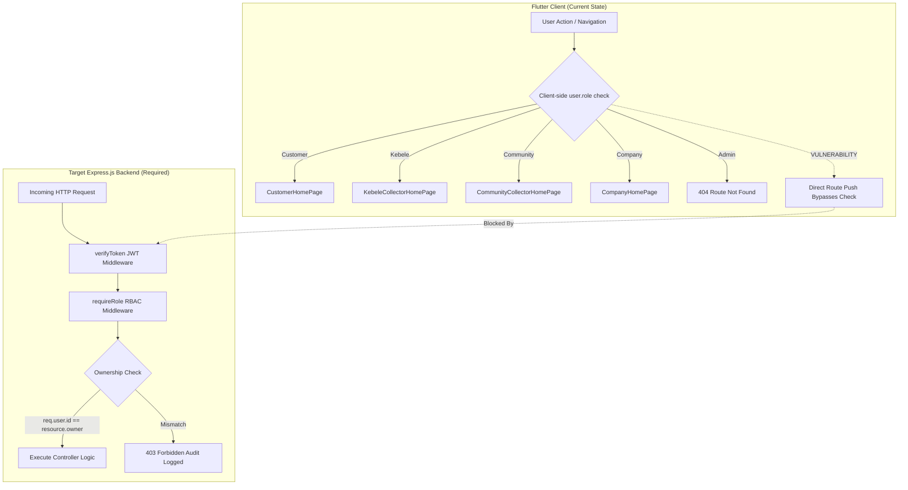
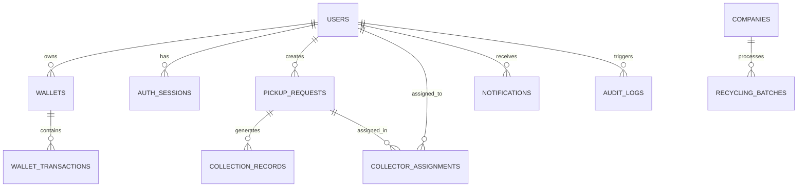
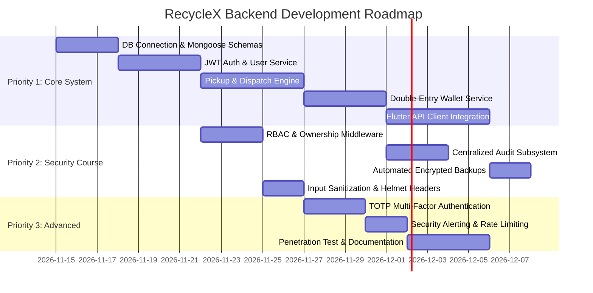

# RecycleX – Complete Frontend Audit and Backend Requirements Analysis

**Course:** Computer System Security Project  
**Institution:** Addis Ababa Science and Technology University (AASTU)  
**Role:** Senior Flutter Developer, Backend Architect & Application Security Analyst  
**Platform:** RecycleX – Waste Collection & Resource Recovery Platform  
**Target Backend Stack:** Node.js, Express.js, TypeScript, MongoDB (Mongoose), JWT, RBAC  

---

## Executive Summary

A comprehensive source-code level audit of the **RecycleX** Flutter frontend (`lib/` directory, 42 Dart source files, unit/widget tests, and asset manifests) was conducted. The analysis examined navigation graphs, state management providers, models, local services, network layers, UI components, and mock structures.

### Key Audit Findings

1. **Dual Architectural Disconnect:**  
   The codebase contains remnants of an initial Firebase implementation (`firebase_auth`, `cloud_firestore`) alongside an in-memory mock service architecture (`AuthService`, `_usersDb`). Several core screens (`edit_profile.dart`, `wallet.dart`, `emergency_pickup.dart`) fail or fall back when Firebase credentials are absent, while the main app runs on in-memory state.
2. **Network Layer Preparedness vs. Actual Usage:**  
   A centralized HTTP wrapper (`ApiClient` in `lib/core/network/api_client.dart`) and route catalog (`ApiEndpoints` in `lib/core/network/api_endpoints.dart`) have been established. However, **zero UI components currently execute network calls through `ApiClient`**. All data operations are simulated with in-memory objects and `Future.delayed()`.
3. **Orphaned and Shadowed Screens:**  
   Significant chunks of functional UI are completely disconnected from the routing table:
   - `lib/features/collection/presentation/pages/near_by_collectors.dart` (828 lines) is orphaned; `lib/core/routing/app_router.dart` routes `/map` to a minimal 45-line `map_page.dart`.
   - `lib/features/collection/presentation/pages/wallet.dart` (`EcoWalletPage`, 854 lines with reward redemption logic) is orphaned; `/wallet` routes to `lib/features/wallet/presentation/pages/wallet_page.dart` (229 lines, static display).
   - `lib/features/collection/presentation/pages/notification.dart` (notification feed) is shadowed by `lib/features/collection/presentation/pages/notifications_page.dart` (notification settings toggles) due to identical class naming.
   - `lib/components/editProfile.dart` in `lib/components/` is an unused duplicate of `lib/features/collection/presentation/pages/edit_profile.dart`.
4. **Data Volatility:**  
   Pickup scheduling (`schedule_pickup_page.dart`) constructs a `pickupData` map in local state, triggers a local notification, and routes to `schedule_confirmation.dart`, but discards the record immediately upon popping. No state persists to any database or centralized cache.
5. **Security Gaps for the AASTU Assignment:**  
   Current role-based access control is entirely client-side. Passwords exist in plain-text memory (`_LocalUserRecord.password`), sessions are non-expiring in-memory objects without JWT/refresh token exchange, no audit logging pipeline exists, and EcoCoin transactions lack server-side cryptographic ledger validation.

---

# PART 1: Frontend Screen and Feature Inventory

The table below catalogs every screen in the RecycleX application, tracing exact file locations, role access, features, user inputs, actions, required data, backend dependencies, and true implementation status.

### 1.1 Customer Screens

| Screen Name | File Path | User Role | Purpose | Features | User Inputs | Actions | Data Required | Backend Dependency | Current Status |
|---|---|---|---|---|---|---|---|---|---|
| **Customer Home Page** | `lib/features/customer/presentation/pages/customer_home_page.dart` | Customer | Main customer dashboard | EcoCoin banner, 4 quick action tiles, recent pickups placeholder, bottom nav | None | Navigate to schedule, emergency, map, history, notifications, bottom tabs | `UserModel.displayName`, `UserModel.ecoCoins` | `GET /customers/me`, `GET /collections/recent`, `GET /wallet/balance` | **Partial** (Dynamic user banner from Provider; static grid; placeholder pickup list) |
| **Schedule Pickup Page** | `lib/features/collection/presentation/pages/schedule_pickup_page.dart` | Customer | Book scheduled waste collection | Waste type selector, collector type selector (Kebele/Community), date picker, time picker, GPS reverse geocoding location input | Waste type, Collector type, Date, Time, Location string | Date picker, Time picker, GPS locate button, Confirm Schedule dialog, Submit | User identity, current GPS coordinates, reverse geocoding via OpenStreetMap | `POST /collections`, `GET /collectors/available` | **Partial** (UI & validation complete; geocoding works via Nominatim HTTP; submission is simulated in-memory) |
| **Schedule Confirmation Page** | `lib/features/collection/presentation/pages/schedule_confirmation.dart` | Customer | Visual receipt of scheduled pickup | Displays summary card of scheduled waste, collector type, date/time, and pickup address | None | "Back to Home" button | Constructor parameters (`wasteType`, `collectorType`, `pickupDate`, `pickupTime`, `location`) | `GET /collections/:id` | **UI only** (Stateless receipt display receiving route args) |
| **Emergency Pickup Page** | `lib/features/collection/presentation/pages/emergency_pickup.dart` | Customer | Immediate/urgent waste dispatch | Urgent waste category selector, reason text field, contact info, GPS location resolution, 50 EcoCoin deduction | Category, urgency reason, address, contact name, phone number | Auto-load GPS, submit emergency request, success modal | Current user profile, live device coordinates, wallet balance | `POST /collections/emergency`, `POST /wallet/deduct` | **Partial** (Contains legacy Firestore write inside try/catch; swallows errors; simulated dialog) |
| **Map Page** | `lib/features/customer/presentation/pages/map_page.dart` | Customer | Quick map view of nearest collector | Embedded Google Map showing user marker and 1 static hardcoded collector marker at (9.03, 38.74) | None | Map pan/zoom, "my location" button | `LatLng userLocation` (passed via route settings) | `GET /collectors/nearby?lat=&lng=&radius=` | **Partial** (Functional Google Map widget, but uses static hardcoded markers) |
| **Nearby Collectors Page** | `lib/features/collection/presentation/pages/near_by_collectors.dart` | Customer | Comprehensive collector locator & filter | Google Map with custom markers, horizontal list of 5 hardcoded collectors, category filters (All, Kebele, Community, Company) | Filter chip selection | Tap marker, select collector, direct call/contact | 5 static `Collector` instances in Addis Ababa | `GET /collectors?type=&lat=&lng=` | **Orphaned / UI only** (828 lines of UI, but unrouted in `AppRouter`) |
| **Collection History Page** | `lib/core/routing/app_router.dart` (`_PlaceholderPage`) | Customer | Review past pickup records | Displays "Collection History\n(Coming soon)" centered text | None | Back button | Historical pickups list | `GET /customers/me/history` | **Missing / Placeholder** |

---

### 1.2 Kebele Collector Screens

| Screen Name | File Path | User Role | Purpose | Features | User Inputs | Actions | Data Required | Backend Dependency | Current Status |
|---|---|---|---|---|---|---|---|---|---|
| **Kebele Collector Home Page** | `lib/features/collector/presentation/pages/kebele_collector_home_page.dart` | Kebele Collector | Municipal collector operations center | 3-tab layout: **Home** (Duty toggle, officer card, daily quota 820/1000kg, quick actions, active zone requests), **Zone Routes** (Routes A–D), **Requests** (Request list) | On-duty toggle, route acceptance | Switch on/off duty, "Scan QR", "Add Log", "Accept Route" | Static lists: 3 `_KebelePickupRequest`, 4 `_RouteCard` | `GET /collectors/me/routes`, `PATCH /collectors/me/duty-status`, `POST /collections/:id/accept` | **Partial** (Polished UI; state changes local to widget; actions trigger SnackBars) |
| **Collector Home Page (Generic)** | `lib/features/collector/presentation/pages/collector_home_page.dart` | Collector (Generic) | Early iteration of collector dashboard | Earnings card, pending requests placeholder | None | Switch availability | Static placeholders | `GET /collectors/me/earnings` | **Deprecated / Bypassed** (Superseded by `KebeleCollectorHomePage`) |

---

### 1.3 Community Collector Screens

| Screen Name | File Path | User Role | Purpose | Features | User Inputs | Actions | Data Required | Backend Dependency | Current Status |
|---|---|---|---|---|---|---|---|---|---|
| **Community Collector Home Page** | `lib/features/collector/presentation/pages/community_collector_home_page.dart` | Community Collector | Cooperative & neighborhood recycling hub | 3-tab layout: **Home** (Drop-off acceptance toggle, co-op info, drop-off stats, quick actions, active drives), **Stations** (4 drop-off bins), **Cleanups** (3 community volunteer cleanup drives) | Accept drop-offs toggle, cleanup join toggle | Toggle drop-offs, "Log Drop-off", "Report Bin", "Join Clean-up Drive" | Static lists: 4 `_DropoffStation`, 3 `_Drive` | `GET /community/stations`, `POST /community/drives/:id/volunteer`, `POST /community/dropoffs/log` | **Partial** (Interactive local state for volunteer sign-up and toggles; no remote sync) |

---

### 1.4 Company Screens

| Screen Name | File Path | User Role | Purpose | Features | User Inputs | Actions | Data Required | Backend Dependency | Current Status |
|---|---|---|---|---|---|---|---|---|---|
| **Company Home Page** | `lib/features/company/presentation/pages/company_home_page.dart` | Company | Bulk recycling & industrial processing center | 4-tab layout: **Home** (Monthly processed weight 12,480 kg, quick action buttons, incoming shipments), **Materials** (PET, Paper, Scrap Metal, Glass batches), **Analytics** (volume distribution charts), **Profile** | None (read & status view) | "Book Batch", "Log Shipment", tab switching | Static lists: 4 `_MaterialBatch`, 3 `_Shipment` | `GET /companies/me/materials`, `GET /companies/me/shipments`, `GET /companies/me/analytics` | **Partial** (Styling strictly preserved; rich mock datasets; SnackBars on actions) |

---

### 1.5 Admin Screens

| Screen Name | File Path | User Role | Purpose | Features | User Inputs | Actions | Data Required | Backend Dependency | Current Status |
|---|---|---|---|---|---|---|---|---|---|
| **Admin Dashboard** | `lib/core/routing/app_router.dart` / None | Admin | System oversight, role management, audit inspection | Referenced in router helper (`/admin/dashboard`), but route resolves to `_NotFoundPage` | None | None | System metrics, user accounts, audit logs | `GET /admin/stats`, `GET /admin/users`, `GET /admin/audit-logs` | **Missing** (Zero UI implemented; returns 404 page) |

---

### 1.6 Shared Screens and Infrastructure Components

| Screen / Component | File Path | Purpose | Key Sub-elements / Features | Implementation Status |
|---|---|---|---|---|
| **Splash Screen** | `lib/features/auth/presentation/pages/splash_screen.dart` | Initial app entry & branding animation | Leaf logo, title, 1.2s fade transition, 3.0s auto-navigation timer to `/onboarding` | **Implemented** |
| **Onboarding Page** | `lib/features/auth/presentation/pages/onboarding_page.dart` | Multi-slide feature introduction | Top-bar Skip button (hidden on slide 3), PageView with 3 responsive slides, animated dot indicators, Next/Get Started button | **Implemented** (100% verified via automated tests) |
| **Login Page** | `lib/features/auth/presentation/pages/login_page.dart` | Email/Password & Google authentication | Form validation, password visibility toggle, 1-Click demo accounts dropdown (Customer, Kebele, Community, Company), Google Sign-In button | **Implemented** (Simulated authentication; connects to `AuthProvider`) |
| **Register Page** | `lib/features/auth/presentation/pages/register_page.dart` | Account creation | Full name, email, phone with country code (`+251`), password confirmation, optional role selector, welcome bonus banner, Google button | **Implemented** (Validates inputs, stores phone locally, simulates account creation) |
| **Forgot Password Page** | `lib/features/auth/presentation/pages/forgot_password_page.dart` | Credential recovery | Centered card, email input with validation, standard green submit button, simulated delay, success confirmation view | **Implemented** (Frontend interaction complete; backend endpoint stubbed) |
| **Profile Page** | `lib/features/profile/presentation/pages/profile_page.dart` | User profile overview & account settings | Curved header with avatar, stats card (recycled, pickups, coins), menu rows (Edit Profile, Notifications, Language, Dark Mode toggle, Logout) | **Partial** (Header & stats bound to `AuthProvider`; Privacy, Language, and Dark Mode are stubs) |
| **Edit Profile Page** | `lib/features/collection/presentation/pages/edit_profile.dart` | Edit personal details & address | Name, email (read-only), phone, address, city dropdown, profile photo picker (`ImagePicker`) | **Partial** (Contains direct Firebase writes; fails gracefully with SnackBar when running in-memory) |
| **Edit Profile (Duplicate)** | `lib/components/editProfile.dart` | Legacy edit profile component | Redundant copy of edit profile with hardcoded text controllers | **Deprecated / Dead Code** |
| **Wallet Page (Active)** | `lib/features/wallet/presentation/pages/wallet_page.dart` | Read-only EcoCoin balance display | EcoCoin gradient balance card, quick actions (Send, Receive, Redeem), mock activity list | **Partial** (Bound to `Routes.wallet`; displays balance from Provider; actions are non-functional) |
| **Eco Wallet Page (Orphaned)** | `lib/features/collection/presentation/pages/wallet.dart` | Complete wallet & rewards store | Balance card, reward redemption catalog (metal straws, tote bag, tree planting), Firestore transaction stream | **Orphaned / Dead Code** (854 lines; not mapped in `AppRouter`) |
| **Notifications Settings Page** | `lib/features/collection/presentation/pages/notifications_page.dart` | Notification preference management | Toggles for pickups, EcoCoins, promotions, newsletter, sound, vibration, quiet hours time picker | **Implemented** (Mapped to `/notifications`; uses local boolean state) |
| **Notification Feed Page** | `lib/features/collection/presentation/pages/notification.dart` | User notification inbox/feed | List of received notification cards (welcome bonus, pickup confirmations) | **Shadowed / Unrouted** (Overridden by `notifications_page.dart`) |
| **Customer Bottom Nav** | `lib/components/customer_bottom_nav.dart` | Bottom navigation bar for customer role | 4 navigation tabs: Home, Schedule, Wallet, Profile | **Implemented** |
| **Google Sign-In Button** | `lib/features/auth/presentation/widgets/google_sign_in_button.dart` | Reusable auth component | Vector-rendered multicolor Google "G" logo via `CustomPainter`, standard white pill button | **Implemented** |

---

# PART 2: User Roles and Permission Matrix

RecycleX defines five distinct user roles in `lib/core/constants/app_strings.dart` and `lib/features/auth/models/user_model.dart`:
1. **Customer** (`customer`): Residential and individual waste generators.
2. **Kebele Collector** (`kebele_collector`): Municipal sanitation workers assigned to administrative zones and routes.
3. **Community Collector** (`community_collector`): Youth cooperatives and local micro-enterprises managing drop-off centers and cleanup drives.
4. **Company** (`company`): Commercial recycling plants and aggregators purchasing bulk materials.
5. **Admin** (`admin`): Municipal regulators and platform supervisors.

### 2.1 Role-Based Access Control (RBAC) Matrix

| Feature / Permission | Customer | Kebele Collector | Community Collector | Company | Admin | Enforcement Mechanism |
|---|---|---|---|---|---|---|
| **Register & Login** | ALLOW | CONDITIONAL (Requires Zone) | CONDITIONAL (Requires CBO) | DENY (Admin Provisioned) | DENY (Direct DB Seed) | Frontend Form + Backend JWT Auth |
| **View Own Profile** | ALLOW | ALLOW | ALLOW | ALLOW | ALLOW | Backend (`req.user.id == resource.userId`) |
| **Update Own Profile** | ALLOW | CONDITIONAL (Cannot alter Zone) | CONDITIONAL (Cannot alter Org) | CONDITIONAL (Company info only) | ALLOW | Backend Validation |
| **View Other Users' Profiles** | DENY | CONDITIONAL (Assigned Customers) | CONDITIONAL (Assigned Customers) | DENY | ALLOW | Backend Query Scoping |
| **Create Pickup Requests** | ALLOW | DENY | DENY | DENY | DENY | Backend (`role == 'customer'`) |
| **View Pickup Requests** | CONDITIONAL (Own only) | CONDITIONAL (Zone only) | CONDITIONAL (Hub/Station only) | CONDITIONAL (Bulk shipments) | ALLOW | Backend Tenant/Owner Filtering |
| **Update Pickup Requests** | CONDITIONAL (Cancel if pending) | CONDITIONAL (Status only) | CONDITIONAL (Status only) | DENY | ALLOW | Backend State Machine Guard |
| **Assign Collectors** | DENY | DENY | DENY | DENY | ALLOW | Backend Admin Route |
| **Accept / Reject Pickups** | DENY | ALLOW (Within assigned zone) | ALLOW (Within co-op radius) | DENY | ALLOW | Backend Role Check + Zone Verification |
| **Mark Pickups as Completed** | DENY | ALLOW (With scale verification) | ALLOW (With scale verification) | DENY | ALLOW | Backend Scale & QR Verification |
| **Manage Recycling Batches** | DENY | DENY | CONDITIONAL (Station bins) | ALLOW (Factory inventory) | ALLOW | Backend Ownership Check |
| **View EcoCoin Balance** | ALLOW | ALLOW | ALLOW | ALLOW | ALLOW | Backend Wallet Service |
| **Receive EcoCoins** | ALLOW (For recycling) | ALLOW (Service compensation) | ALLOW (Service compensation) | DENY | DENY | Backend Ledger Service |
| **Transfer / Redeem Coins** | ALLOW | DENY | DENY | DENY | DENY | Backend ACID Transaction |
| **View Transaction History** | CONDITIONAL (Own only) | CONDITIONAL (Own only) | CONDITIONAL (Own only) | CONDITIONAL (Own only) | ALLOW | Backend Owner Scope (`userId == token.uid`) |
| **Manage Users & Ban** | DENY | DENY | DENY | DENY | ALLOW | Backend Admin Authorization |
| **Assign & Revoke Roles** | DENY | DENY | DENY | DENY | ALLOW | Backend Superadmin Guard |
| **View System Audit Logs** | DENY | DENY | DENY | DENY | ALLOW | Backend Audit Subsystem |
| **Manage System Settings** | DENY | DENY | DENY | DENY | ALLOW | Backend Admin Guard |

### 2.2 Access Control & Security Findings



- **Client-Side Enclosure Only:**  
  Currently, role isolation is enforced *only* inside `lib/core/routing/app_router.dart` via `AppRouter.homeRouteForRole(auth.userRole)`. If a malicious client pushes named routes directly (`Navigator.pushNamed(context, '/company/home')`), the Flutter widget tree mounts the dashboard without verifying server authorizations.
- **Complete Lack of Ownership Checks:**  
  The frontend currently displays mock arrays without verifying whether the active user ID matches the creator ID (`userId`).
- **Required Backend Enforcement:**  
  The Node.js backend must enforce strict JWT-based middleware (`verifyToken`, `authorizeRoles(['admin', ...])`) and resource-level ownership validation (`req.user._id.equals(pickup.customer)`) for every CRUD endpoint.

---

# PART 3: Complete User Workflows

### Workflow 1: User Registration and Login
- **Starting Screen:** `splash_screen.dart` $\to$ `onboarding_page.dart` $\to$ `login_page.dart`.
- **Actions Performed:**  
  1. User selects "Create New Account" $\to$ navigates to `register_page.dart`.
  2. Enters Full Name, Email, Phone (+251), Password, Password Confirmation, and optional Collector Role details.
  3. Clicks "Create Account".
- **Data Collected:** `displayName`, `email`, `phoneNumber`, `password`, `role`, `collectorType`, `zoneOrOrganization`.
- **Current Implementation:** Handled in `auth_service.dart`. Creates a local `UserModel` with 100 EcoCoins and stores plain-text credentials in `_usersDb`.
- **Where It Stops:** Data lives exclusively in process memory and disappears upon app restart.
- **Backend APIs Required:** `POST /api/v1/auth/register`, `POST /api/v1/auth/login`, `GET /api/v1/auth/me`.
- **Security Checks Necessary:** bcrypt password hashing (work factor $\ge 12$), rate-limiting on auth attempts (max 5 per minute), email uniqueness check, E.164 phone sanitization, role escalation protection (preventing users from registering as `admin`).

---

### Workflow 2: Customer Pickup Request Creation
- **Starting Screen:** `customer_home_page.dart`.
- **Actions Performed:**  
  1. Clicks "Schedule Pickup" tile $\to$ navigates to `schedule_pickup_page.dart`.
  2. Selects Waste Type (Plastic, Paper, Glass, Metal, Organic, E-Waste).
  3. Selects Collector Category (Kebele Collector vs. Community Collector).
  4. Selects Date (calendar modal) and Time (time picker modal).
  5. Clicks "Locate Me" (invokes `LocationService.getCurrentLocation()` and fetches street name via OpenStreetMap Nominatim reverse geocoding).
  6. Clicks "Schedule Pickup" $\to$ reviews details in `AlertDialog` $\to$ clicks "Confirm & Schedule".
- **Data Collected:** `wasteType`, `collectorType`, `pickupDate`, `pickupTime`, `locationText`, `latitude`, `longitude`.
- **Current Implementation:** Assembles local `pickupData` map, triggers local push notification, and navigates to `schedule_confirmation.dart`.
- **Where It Stops:** The pickup data is never stored in any persistent collection or sent to collectors.
- **Backend APIs Required:** `POST /api/v1/collections`, `GET /api/v1/collectors/available?zone=`.
- **Security Checks Necessary:** Input sanitization on location string (preventing XSS/NoSQL injection), pickup date validation (must be in future, within 30 days), verification that requesting user has an active, non-suspended account.

---

### Workflow 3: Pickup Request Assignment
- **Starting Screen:** System background / municipal dispatcher.
- **Current Implementation:** **Completely missing.** The frontend allows the user to choose between "Kebele Collector" and "Community Collector", but has zero dispatch or assignment logic.
- **Where It Stops:** Static string `'Kebele Collector'` is passed to the receipt screen.
- **Backend APIs Required:** `POST /api/v1/collections/:id/assign`, `GET /api/v1/collectors/zone/:zoneId`.
- **Security Checks Necessary:** Assignment authorization must be restricted to system dispatch algorithms or verified municipal supervisors; collectors cannot reassign jobs outside their jurisdictions.

---

### Workflow 4: Kebele Collector Workflow
- **Starting Screen:** `kebele_collector_home_page.dart`.
- **Actions Performed:**  
  1. Collector toggles "On Duty" switch in AppBar.
  2. Inspects Daily Target quota card (820 / 1,000 kg).
  3. Switches to "Zone Routes" tab $\to$ views assigned residential blocks.
  4. Switches to "Requests" tab $\to$ views pending pickups $\to$ clicks "Accept Route".
- **Data Collected:** Duty state toggle, route acceptance acknowledgement.
- **Current Implementation:** All data is in-memory mock lists (`_requests`, `_zoneRoutes`).
- **Where It Stops:** Clicking "Accept Route" displays a local SnackBar; no status changes persist.
- **Backend APIs Required:** `PATCH /api/v1/collectors/me/duty-status`, `GET /api/v1/collectors/me/routes`, `POST /api/v1/collections/:id/accept`.
- **Security Checks Necessary:** Verify collector belongs to the specific Kebele Woreda; verify collector is on active duty before allowing route pickup acceptance.

---

### Workflow 5: Community Collector Workflow
- **Starting Screen:** `community_collector_home_page.dart`.
- **Actions Performed:**  
  1. Toggles "Accepting Drop-offs" switch.
  2. Views drop-off stations (bin capacities, full alerts).
  3. Views community cleanup drives $\to$ clicks "Join Clean-up Drive" (toggles volunteer status and increments count from 38 to 39).
- **Data Collected:** Volunteer status, drop-off intake logs.
- **Current Implementation:** Pure widget `setState()` on static objects.
- **Where It Stops:** Data resets on tab switch or reload.
- **Backend APIs Required:** `GET /api/v1/community/stations`, `POST /api/v1/community/drives/:id/join`, `POST /api/v1/community/dropoffs`.
- **Security Checks Necessary:** Rate-limiting volunteer registrations; verifying cooperative credentials for drop-off center logging.

---

### Workflow 6: Company Workflow
- **Starting Screen:** `company_home_page.dart`.
- **Actions Performed:**  
  1. Reviews monthly processed materials (12,480 kg).
  2. Inspects incoming shipment queue.
  3. Switches to "Materials" tab $\to$ views bulk batches (PET, Cardboard, Metal, Glass).
  4. Switches to "Analytics" tab $\to$ reviews material distribution bars.
- **Data Collected:** Batch booking requests, shipment confirmations.
- **Current Implementation:** Read-only UI backed by static classes (`_MaterialBatch`, `_Shipment`).
- **Where It Stops:** "Book Batch" and "Log Shipment" trigger SnackBars; no transactions are registered.
- **Backend APIs Required:** `GET /api/v1/companies/me/inventory`, `POST /api/v1/companies/batches/purchase`, `GET /api/v1/companies/analytics`.
- **Security Checks Necessary:** Corporate account verification; audit trail logging for industrial-scale waste transfers.

---

### Workflow 7: Pickup Completion & Verification
- **Starting Screen:** Collector dashboard (Requests tab).
- **Current Implementation:** **Completely missing.** There is no workflow for entering final collected weights, scanning user QR codes, or confirming waste handoff.
- **Where It Stops:** The concept exists only in static labels (`Status: Completed`).
- **Backend APIs Required:** `POST /api/v1/collections/:id/complete` (payload: `actualWeightKg`, `wastePurityScore`, `customerSignatureOrOtp`).
- **Security Checks Necessary:** Dual verification: collector submits weight + customer confirms via OTP/QR code to prevent phantom pickups and fraudulent EcoCoin minting.

---

### Workflow 8: EcoCoin Earning & Wallet Updates
- **Starting Screen:** `wallet_page.dart` / `customer_home_page.dart`.
- **Actions Performed:** Displays user's coin balance (initialized to 100 on signup).
- **Current Implementation:** Read from `auth.appUser?.ecoCoins`. Deductions are attempted in `emergency_pickup.dart` (-50 coins) and `wallet_service.dart`, but fail silently when Firestore is disconnected.
- **Where It Stops:** Balance is static in Provider; no backend ledger exists.
- **Backend APIs Required:** `GET /api/v1/wallet/balance`, `GET /api/v1/wallet/transactions`, `POST /api/v1/wallet/redeem`.
- **Security Checks Necessary:** ACID transaction isolation in MongoDB (`mongoose.startSession()`); server-side balance checks; strict cryptographic idempotency keys on reward redemption requests.

---

### Workflow 9: Profile Management
- **Starting Screen:** `profile_page.dart`.
- **Actions Performed:** User clicks edit icon $\to$ navigates to `edit_profile.dart` $\to$ updates Name, Phone, Address, City $\to$ clicks Save.
- **Current Implementation:** Calls `FirebaseAuth.instance.currentUser` and `FirebaseFirestore.instance.collection('users')`. Since `FirebaseAuth.currentUser` is `null` in mock mode, it displays `'No user logged in'`.
- **Where It Stops:** Profile edits cannot be saved in the current mock setup.
- **Backend APIs Required:** `GET /api/v1/users/me`, `PUT /api/v1/users/me`, `POST /api/v1/users/me/avatar`.
- **Security Checks Necessary:** File magic byte validation on uploaded avatars; restriction preventing customers from altering their assigned roles or email verification flags.

---

### Workflow 10: Notifications
- **Starting Screen:** AppBar notification bell $\to$ `notifications_page.dart`.
- **Actions Performed:** User toggles notification preferences (Pickups, EcoCoins, Promotions).
- **Current Implementation:** Pure widget `setState()` on local booleans. Local foreground push notifications are triggered via `NotificationService` for pickup scheduling.
- **Where It Stops:** Preferences are not persisted across app restarts; remote push notification tokens (FCM/APNS) are not registered with any server.
- **Backend APIs Required:** `GET /api/v1/notifications`, `PATCH /api/v1/notifications/preferences`, `POST /api/v1/notifications/device-token`.
- **Security Checks Necessary:** Sanitization of notification payloads; device token validation.

---

### Workflow 11: Logout and Session Handling
- **Starting Screen:** `profile_page.dart`.
- **Actions Performed:** User taps "Logout" button $\to$ calls `auth.signOut()` $\to$ `Navigator.pushReplacementNamed(context, '/login')`.
- **Current Implementation:** Calls `AuthService.signOut()` which resets `_currentUser = null` and emits `null` on the stream.
- **Where It Stops:** Since no tokens are stored in secure local storage, logout is simply an in-memory reset.
- **Backend APIs Required:** `POST /api/v1/auth/logout` (revoking refresh token in database).
- **Security Checks Necessary:** Invalidation of active JWT refresh tokens in MongoDB session store; clearing all cached sensitive user data from memory.

---

# PART 4: Data Model and Database Requirements

To support the existing Flutter frontend and fulfill the AASTU Computer System Security course requirements, the future Node.js backend requires the following MongoDB collections.



### Proposed MongoDB Collections

| Collection | Key Fields | Purpose | Relationships | Security Considerations | Requirement Source |
|---|---|---|---|---|---|
| **`users`** | `_id`, `email`, `passwordHash`, `displayName`, `phoneNumber`, `role`, `status`, `isEmailVerified`, `zoneOrOrganization`, `failedLoginAttempts`, `lockoutUntil`, `mfaEnabled`, `mfaSecret`, `createdAt`, `updatedAt` | Core identity & credentials | Referenced by all business collections | Passwords hashed with bcrypt; lockout after 5 failed attempts; MFA secrets encrypted at rest | Existing App + Security Assignment (RBAC, Auth, MFA) |
| **`roles_permissions`** | `_id`, `roleName`, `description`, `permissions` (array of strings, e.g., `pickups:create`, `audit:read`) | Dynamic RBAC engine | Referenced by `users.role` | Immutable except by Superadmin; checked on every protected route | Security Assignment (RBAC requirement) |
| **`role_change_requests`** | `_id`, `userId`, `requestedRole`, `justification`, `status` (`pending`, `approved`, `rejected`), `reviewedBy`, `reviewedAt` | Approval workflow for collector/company promotions | References `users` | Prevents privilege escalation; mandatory maker-checker rule | Security Assignment (Access Control) |
| **`pickup_requests`** | `_id`, `customer` (`userId`), `wasteType`, `collectorType`, `pickupDateTime`, `location`: `{ text, coordinates: [lng, lat] }`, `isUrgent`, `emergencyReason`, `status` (`pending`, `assigned`, `in_progress`, `completed`, `cancelled`), `cancellationReason`, `createdAt` | Waste collection orders | Belongs to `users` (customer); referenced by `collector_assignments` | GeoJSON 2dsphere index for proximity search; customer can only edit while `pending` | Existing App (`schedule_pickup_page`, `emergency_pickup`) |
| **`collector_assignments`** | `_id`, `pickupId`, `collectorId`, `assignedAt`, `status` (`offered`, `accepted`, `rejected`, `timeout`), `rejectionReason` | Route allocation and tracking | References `pickup_requests` and `users` | Prevents race conditions with MongoDB atomic operators (`$setOnInsert`) | Existing App (Collector Dashboards) |
| **`collection_records`** | `_id`, `pickupId`, `collectorId`, `customerId`, `measuredWeightKg`, `wasteCategory`, `qualityRating`, `ecoCoinsAwarded`, `verificationMethod` (`qr_code`, `otp`), `completedAt` | Immutable proof of physical waste handoff | References `pickup_requests`, `users` | Immutable audit record; triggers automated wallet ledger credit | Existing App + Security Assignment |
| **`companies`** | `_id`, `userId`, `companyName`, `licenseNumber`, `tinNumber`, `facilityAddress`, `acceptedMaterials`, `totalProcessedKg`, `verified` | Industrial recycling aggregators | References `users` | Commercial regulatory compliance check; license validation | Existing App (`company_home_page`) |
| **`recycling_batches`** | `_id`, `companyId`, `batchCode`, `materialType`, `weightKg`, `sourceZone`, `purityGrade`, `receivedAt` | Industrial material inventory | References `companies` | Prevents supply chain falsification | Existing App (`company_home_page` Materials tab) |
| **`wallets`** | `_id`, `userId`, `balance`, `totalEarned`, `totalRedeemed`, `status` (`active`, `frozen`), `lastTransactionAt` | Financial ledger account for EcoCoins | One-to-one with `users` | Balance must strictly equal sum of ledger transactions; non-negative constraint | Existing App (`wallet_page`, `wallet.dart`) |
| **`wallet_transactions`** | `_id`, `walletId`, `userId`, `type` (`earn`, `redeem`, `transfer`, `penalty`, `bonus`), `amount`, `balanceAfter`, `referenceType` (`collection`, `reward`, `welcome`), `referenceId`, `idempotencyKey`, `createdAt` | Double-entry ledger audit trail | References `wallets`, `users` | Append-only (no update/delete permitted); cryptographic hash chaining | Existing App (`transaction_model.dart`) |
| **`notifications`** | `_id`, `userId`, `title`, `body`, `type`, `read`, `metadata`, `createdAt` | User notification inbox | References `users` | Scoped strictly to recipient; rate-limited creation | Existing App (`notification.dart`) |
| **`auth_sessions`** | `_id`, `userId`, `refreshTokenHash`, `deviceInfo`, `ipAddress`, `userAgent`, `expiresAt`, `isValid`, `createdAt` | Session management & revocation | References `users` | Refresh token rotation; immediate revocation on suspicious IP/device change | Security Assignment (Session Management) |
| **`audit_logs`** | `_id`, `actorId`, `actorRole`, `action`, `resource`, `resourceId`, `ipAddress`, `userAgent`, `status` (`success`, `failure`), `details`, `timestamp` | Tamper-evident administrative audit log | References `users` | Append-only; write-protected; offsite SIEM replication | Security Assignment (Audit Trails & Logging) |
| **`security_alerts`** | `_id`, `severity` (`low`, `medium`, `high`, `critical`), `eventType` (`brute_force`, `privilege_escalation`, `unauthorized_access`), `targetUserId`, `ipAddress`, `metadata`, `resolved`, `createdAt` | Security incident monitoring | References `users` | Triggers real-time alerts to security administrators | Security Assignment (Incident Response) |

---

# PART 5: Frontend Security Audit

The frontend codebase was audited across 11 key application security areas.

| # | Security Area & Issue | Evidence / File Path | Risk Level | Required Solution | Where to Enforce |
|---|---|---|---|---|---|
| **1** | **Hardcoded Plain-Text Passwords in Memory** | `auth_service.dart`: `password: 'password123'` stored in static `Map<String, _LocalUserRecord>`. | **Critical** | Remove in-memory user registry; authenticate exclusively via backend using salted bcrypt/Argon2 hashes. | Backend |
| **2** | **Simulated / Client-Side Auth Bypass** | `auth_service.dart`: Any arbitrary email not in database is auto-provisioned and logged in. | **Critical** | Remove auto-provisioning backdoor; require genuine registration and server credential validation. | Backend |
| **3** | **Unprotected Navigation-Based Access Control** | `app_router.dart`: Roles are inspected only to choose redirect route. No guard on direct route pushes. | **High** | Implement route guards in Flutter (`onGenerateRoute` checking auth token & role) AND enforce strict RBAC on every API endpoint. | Both (Frontend & Backend) |
| **4** | **Unauthenticated / Insecure API Client** | `api_client.dart`: Token is static in-memory variable `_authToken`. Lost on reload; vulnerable to memory dumps. | **High** | Store tokens using `flutter_secure_storage` (encrypted shared preferences / keychain); implement automated refresh token rotation. | Frontend Client |
| **5** | **Plaintext HTTP Base URL** | `api_endpoints.dart`: `baseUrl = 'http://localhost:3000/api/v1'` uses unencrypted HTTP. | **High** | Enforce HTTPS/TLS 1.3 in production; reject cleartext traffic in Android manifest (`android:usesCleartextTraffic="false"`). | Both |
| **6** | **Client-Side EcoCoin Balance Manipulation** | `emergency_pickup.dart`: Client directly issues `FieldValue.increment(-50)`. | **Critical** | Never allow clients to mutate coin balances directly. Wallets must be updated exclusively by backend transaction services. | Backend |
| **7** | **Lack of Input Sanitization & Length Limits** | `register_page.dart`, `schedule_pickup_page.dart`: Text fields do not limit character length or filter control characters. | **Medium** | Enforce client input formatters (`LengthLimitingTextInputFormatter`) and strict server schema validation (using Joi / Zod). | Both |
| **8** | **Direct Unauthenticated Third-Party API Call** | `location_service.dart`: Makes direct HTTP requests to OpenStreetMap Nominatim with hardcoded User-Agent. | **Medium** | Proxy geocoding requests through backend API to hide device IPs, rate-limit queries, and prevent third-party tracking. | Backend Proxy |
| **9** | **Unvalidated Image Picking Without MIME Checks** | `edit_profile.dart`: Selects file directly from gallery without size, MIME, or magic-byte validation. | **Medium** | Validate file extension, limit upload size ($\le 5\,\text{MB}$), and verify magic bytes on server before storage. | Both |
| **10** | **Production Console Logging of PII & Auth Data** | `edit_profile.dart`: Prints UID, email, address, and phone directly to console using `print()`. | **Low** | Replace with structured logger; disable all debug printing in release mode (`kReleaseMode`). | Frontend Client |
| **11** | **Absence of Session Expiry & Token Invalidation** | `auth_service.dart`: No concept of token lifetimes, idle session timeouts, or server-side blacklisting. | **High** | Implement short-lived access JWTs (15 mins) and long-lived refresh tokens (7 days) with DB revocation checks. | Backend |

---

# PART 6: Backend API Requirements

Based on the frontend UI screens, inputs, and security requirements, the Node.js/Express backend must expose the following RESTful endpoints under `/api/v1`.

### 6.1 Authentication Module (`/api/v1/auth`)

| Method | Endpoint | Purpose | Required Role | Auth Required | Key Validations & Security Rules |
|---|---|---|---|---|---|
| `POST` | `/auth/register` | Register new customer or collector | Public | No | Validate email format, password complexity ($\ge 8$ chars, 1 upper, 1 lower, 1 digit, 1 special), E.164 phone; prevent direct `admin`/`company` registration. |
| `POST` | `/auth/login` | Authenticate and obtain JWT pair | Public | No | Rate limit (5 attempts/min); return access token (15m) + httpOnly refresh cookie (7d); record audit log. |
| `POST` | `/auth/refresh` | Rotate access token | Public | Cookie | Validate refresh token against `auth_sessions`; issue new rotated token pair; revoke stolen tokens. |
| `POST` | `/auth/logout` | Revoke session | Authenticated | Yes | Invalidate session ID in `auth_sessions`; clear client cookies. |
| `POST` | `/auth/forgot-password` | Initiate password reset | Public | No | Rate limit (3/hour); generate crypto-random reset token (expires 1 hour); email link without revealing user existence. |
| `POST` | `/auth/reset-password` | Complete password reset | Public | No | Validate token hash; enforce new password $\ne$ old password; revoke all active user sessions. |
| `GET` | `/auth/me` | Fetch active user profile | Authenticated | Yes | Return current user payload based on verified JWT claims. |

### 6.2 User Management Module (`/api/v1/users`)

| Method | Endpoint | Purpose | Required Role | Auth Required | Key Validations & Security Rules |
|---|---|---|---|---|---|
| `GET` | `/users/me` | Get full profile details | Authenticated | Yes | Enforce ownership (`req.user.id`). |
| `PUT` | `/users/me` | Update name, phone, address | Authenticated | Yes | Sanitize inputs; prevent modification of `role`, `ecoCoins`, or `emailVerified`. |
| `POST` | `/users/me/avatar` | Upload profile image | Authenticated | Yes | Multipart upload; check magic bytes (`image/jpeg`, `image/png`); size $\le 5\,\text{MB}$; store in secure media bucket. |
| `GET` | `/users` | List platform users | `admin` | Yes | Pagination (`page`, `limit`); filtering by role and status. |
| `PATCH` | `/users/:id/status` | Suspend or reactivate user | `admin` | Yes | Prevent self-suspension; record admin audit log with justification. |

### 6.3 Role & Permission Management (`/api/v1/roles`)

| Method | Endpoint | Purpose | Required Role | Auth Required | Key Validations & Security Rules |
|---|---|---|---|---|---|
| `POST` | `/roles/change-requests` | Request collector/company role | `customer` | Yes | Validate justification text; ensure user has no pending requests. |
| `GET` | `/roles/change-requests` | Review pending role promotions | `admin` | Yes | List pending requests with applicant profile metadata. |
| `PATCH` | `/roles/change-requests/:id` | Approve or reject role promotion | `admin` | Yes | Atomic transition; assign zone/organization; log approval event. |

### 6.4 Waste Collection Module (`/api/v1/collections`)

| Method | Endpoint | Purpose | Required Role | Auth Required | Key Validations & Security Rules |
|---|---|---|---|---|---|
| `POST` | `/collections` | Create scheduled pickup | `customer` | Yes | Validate waste type enum; ensure pickup date is future; geo-coordinate bounding check (within Ethiopia/Addis Ababa). |
| `POST` | `/collections/emergency` | Create emergency dispatch pickup | `customer` | Yes | Check wallet has $\ge 50$ EcoCoins; atomically hold 50 coins; mark priority `critical`. |
| `GET` | `/collections/me` | List caller's pickup history | `customer` | Yes | Scoped strictly to `req.user.id`; sort by `createdAt` descending. |
| `GET` | `/collections/:id` | Get pickup details | Owner / Assigned Collector / Admin | Yes | Strict authorization check (`customer == uid || collector == uid || role == 'admin'`). |
| `PATCH` | `/collections/:id/cancel` | Cancel pending pickup | Owner / Admin | Yes | Allowed only if status is `pending` and time to pickup $> 2$ hours. |
| `POST` | `/collections/:id/accept` | Collector accepts pickup | `kebele_collector`, `community_collector` | Yes | Verify collector is on duty; verify request is in collector's zone. |
| `POST` | `/collections/:id/complete` | Complete pickup & record weight | Assigned Collector | Yes | Require `actualWeightKg` ($> 0$), verification OTP or QR token; atomically trigger EcoCoin award. |

### 6.5 Collector & Municipal Operations (`/api/v1/collectors`)

| Method | Endpoint | Purpose | Required Role | Auth Required | Key Validations & Security Rules |
|---|---|---|---|---|---|
| `GET` | `/collectors/nearby` | Find nearby collectors for map | Authenticated | Yes | Require valid `lat`, `lng` query params; sanitize radius ($\le 25\,\text{km}$). |
| `PATCH` | `/collectors/me/duty-status` | Toggle on/off duty | Collectors | Yes | Boolean payload; updates availability in geospatial index. |
| `GET` | `/collectors/me/routes` | Get assigned municipal routes | `kebele_collector` | Yes | Return routes corresponding to collector's assigned Kebele/Woreda. |
| `GET` | `/collectors/me/earnings` | Collector performance & compensation | Collectors | Yes | Return verified aggregated weights, pickups completed, and earnings. |

### 6.6 Company & Industrial Processing (`/api/v1/companies`)

| Method | Endpoint | Purpose | Required Role | Auth Required | Key Validations & Security Rules |
|---|---|---|---|---|---|
| `GET` | `/companies/me/materials` | Available bulk recyclable batches | `company`, `admin` | Yes | Filter by material type (PET, Metal, Glass, Paper) and minimum batch weight. |
| `POST` | `/companies/batches/:id/purchase` | Purchase/claim material batch | `company` | Yes | Atomic state lock on batch; record transaction invoice. |
| `GET` | `/companies/me/analytics` | Monthly processing metrics | `company` | Yes | Aggregate monthly tonnages, cost per kg, and environmental impact. |

### 6.7 Wallet & EcoCoin Subsystem (`/api/v1/wallet`)

| Method | Endpoint | Purpose | Required Role | Auth Required | Key Validations & Security Rules |
|---|---|---|---|---|---|
| `GET` | `/wallet/balance` | Get verified coin balance | Authenticated | Yes | Derived from ledger check; scoped to caller's wallet. |
| `GET` | `/wallet/transactions` | Paginated transaction history | Authenticated | Yes | Scoped strictly to `req.user.id`; pagination parameters. |
| `POST` | `/wallet/redeem` | Redeem EcoCoins for partner reward | `customer` | Yes | Require `rewardId`, `idempotencyKey`; atomic check that `balance >= reward.cost`; write debit ledger entry. |

### 6.8 Audit & Security Monitoring Module (`/api/v1/audit`, `/api/v1/security`)

| Method | Endpoint | Purpose | Required Role | Auth Required | Key Validations & Security Rules |
|---|---|---|---|---|---|
| `GET` | `/audit/logs` | Query administrative audit logs | `admin` | Yes | Strict admin authorization; filter by `actorId`, `action`, date range; read-only. |
| `GET` | `/security/alerts` | Query active security alerts | `admin` | Yes | Returns high/critical alerts (brute-force spikes, privilege escalation). |
| `POST` | `/security/backups/trigger` | Trigger manual system snapshot | `admin` | Yes | Requires secondary password/MFA re-authentication; triggers encrypted dump. |

---

# PART 7: Computer System Security Assignment Mapping

This matrix maps RecycleX to every mandatory security requirement in the AASTU Computer System Security course syllabus.

| Course Assignment Requirement | RecycleX Implementation Reality | Current Status | What Needs to be Developed in Backend | Evidence of Completion |
|---|---|---|---|---|
| **1. Access Control & Authentication: RBAC** | Frontend has 5 roles in `app_strings.dart` and `AppRouter.homeRouteForRole`, but zero server-side access control. | **Partially Implemented** (UI roles designed; backend missing) | Express middleware `authorizeRoles(...roles)` checking role from cryptographically verified JWT claims on every endpoint. | HTTP 403 Forbidden on unauthorized role access tested via automated integration tests. |
| **1. Identification & Registration** | `register_page.dart` collects Name, Email, Phone (+251), Password, and Collector details into local model. | **Partially Implemented** | `POST /auth/register` controller validating identity uniqueness, saving to MongoDB with verification status. | Automated test verifying duplicate email registration rejection. |
| **1. Password Authentication** | `register_page.dart` checks length $\ge 6$. Passwords currently stored in plain text in memory. | **Partially Implemented** | Enforce strong password policy ($\ge 8$ chars, uppercase, lowercase, number, symbol); hash passwords with bcrypt (cost factor 12). | Unit test verifying that database records contain valid bcrypt hashes starting with `$2b$12$`. |
| **1. Token-Based Auth & Session Management** | Client has token field in `ApiClient`, but runs on simulated static state without token issuance. | **Not Implemented** | Issue short-lived RS256/HS256 JWT access tokens (15m) and secure, httpOnly refresh tokens (7d) stored in `auth_sessions`. | Postman/Newman test suite showing access token expiry and successful token rotation. |
| **1. Multi-Factor Authentication (MFA)** | None in codebase. | **Not Implemented** | Time-based One-Time Password (TOTP / RFC 6238) using `speakeasy` library; store encrypted secret in user document; QR code onboarding. | Demonstration of Google Authenticator 6-digit code prompt during login. |
| **2. User Activity Logging** | Codebase contains sporadic `print()` statements in `edit_profile.dart`. | **Not Implemented** | Centralized audit middleware logging every authenticated state-changing action (actor, role, action, IP, timestamp). | Queryable `audit_logs` collection populated after each API action. |
| **2. System Event Logging** | None. Unhandled exceptions are printed to terminal. | **Not Implemented** | Winston / Pino structured JSON logging library capturing server starts, unhandled errors, database connection events, and crashes. | Log file output formatted in JSON with standardized ISO timestamps and severity levels. |
| **2. Log Protection & Integrity** | None. | **Not Implemented** | Write-once append-only access control on log storage; log hashing or HMAC chaining to detect tampering. | Demonstration that modifying an existing log record fails verification. |
| **2. Centralized Monitoring & Alerting** | None. | **Not Implemented** | Automated threshold alert triggering on $\ge 5$ failed logins within 5 minutes or repeated 403 Forbidden events. | Security alert document created in `security_alerts` collection upon simulated attack. |
| **3. Automated Backups** | None. | **Not Implemented** | Automated daily shell script / cron job executing `mongodump` targeting database volume. | Cron schedule configuration file and generated archive `.tar.gz` dumps. |
| **3. Backup Encryption** | None. | **Not Implemented** | GPG / OpenSSL AES-256 symmetric encryption of backup archives prior to disk storage. | Shell execution log showing encrypted `.tar.gz.enc` file and decryption verification. |
| **3. Backup Access Control & Restoration Testing** | None. | **Not Implemented** | Restricted file permissions (`chmod 600`) on backup directory; scripted restoration drill verifying schema consistency. | Documented test run of `mongorestore` onto a clean staging database. |
| **4. Input Validation & Sanitization** | Basic email regex and non-empty checks in Flutter `FormState`. | **Partially Implemented** | Backend Joi / Zod schema validation on every request body, query parameter, and route parameter; NoSQL injection sanitization. | Automated tests submitting Malformed JSON and NoSQL payloads (`{"$gt": ""}`) returning HTTP 400. |
| **4. Output Encoding & XSS Prevention** | Flutter Text widgets encode strings natively, preventing standard web script execution. | **Already Implemented** (Frontend client layer) | Maintain native Flutter widget encoding; set standard HTTP security headers (Helmet.js) on backend responses. | Security header scan showing `X-Content-Type-Options: nosniff`, `Content-Security-Policy`. |
| **4. Secure Error Handling** | Frontend catches errors and surfaces user-friendly SnackBars, but prints stack traces in debug. | **Partially Implemented** | Centralized Express error-handling middleware that logs full trace internally but returns generic sanitized errors to client. | API responses for server errors returning `{ "status": 500, "message": "An unexpected error occurred" }` without stack traces. |
| **4. Security Headers & TLS** | App configured with cleartext HTTP on `localhost:3000`. | **Not Implemented** | Helmet.js integration (HSTS, CSP, X-Frame-Options); enforce HTTPS with valid TLS certificates. | SSL Labs / curl header verification displaying HSTS and Helmet headers. |
| **5. SAST, DAST & Dependency Scanning** | Ran `flutter analyze` (passed on core files; 305 lints in legacy components). | **Partially Implemented** | Implement `npm audit` in backend CI/CD; run OWASP ZAP or Snyk scan across API endpoints. | Clean `npm audit` report and SAST scan log included in project documentation. |
| **5. Penetration Testing** | None performed. | **Not Implemented** | Execute structured penetration testing against API (OWASP Top 10: broken auth, injection, BOLA/IDOR). | Formal Penetration Testing Report document detailing findings and remediations. |
| **6. Incident Response & Disaster Recovery** | None. | **Not Implemented** | Draft formal Incident Response Plan (IRP) document covering Detection, Containment, Eradication, Recovery, and Lessons Learned. | Completed IRP markdown document submitted with course deliverables. |
| **7. Compliance, Governance & Risk Register** | None. | **Not Implemented** | Formulate Risk Register identifying project risks, likelihood, impact, and mitigation controls; privacy policy compliance. | Complete Risk Register table and Data Protection Policy document. |

---

# PART 8: Final Report & Development Recommendations

### 8.1 Recommended Backend Architecture

The backend must be structured as a modular, layered, and security-hardened TypeScript / Express application:

```
Recycle_X_Backend/
├── src/
│   ├── config/             # Environment, DB connection, CORS, Helmet
│   ├── constants/          # Roles, status enums, error codes
│   ├── controllers/        # Request handlers (auth, pickups, wallet, etc.)
│   ├── middleware/         # Security guards (auth, rbac, rateLimiter, validator, audit)
│   ├── models/             # Mongoose schemas & indexes
│   ├── routes/             # API route definitions
│   ├── services/           # Business logic & ACID ledger operations
│   ├── utils/              # Crypto, JWT, logger (Winston), email
│   └── app.ts              # Express application setup
├── scripts/                # Automated backup & restoration test scripts
├── tests/                  # Integration & security test suites
├── package.json
└── tsconfig.json
```

---

### 8.2 Prioritized Development Roadmap



#### Priority 1: Essential Functionality (Production Viability)
*Target: Transitioning the application from simulated prototypes to real data persistence.*

1. **MongoDB Database Initialization & Schema Implementation:**
   - **Why Necessary:** Replaces volatile in-memory storage (`_usersDb`, hardcoded arrays) with persistent document storage.
   - **How Demonstrated:** Creating users and scheduling pickups in Flutter survives complete app and server restarts.
2. **JWT Authentication & Password Hashing Subsystem:**
   - **Why Necessary:** Enables secure registration, login, and session persistence without plain-text credential leaks.
   - **How Demonstrated:** Users log in with genuine credentials, receive JWT tokens, and inspect hashed strings in MongoDB.
3. **Pickup Management & Lifecycle API:**
   - **Why Necessary:** Connects customer scheduling directly to collector dashboards.
   - **How Demonstrated:** A customer schedules a pickup in `schedule_pickup_page.dart`; the request immediately appears in the Kebele Collector's Requests list.
4. **Double-Entry EcoCoin Wallet Service:**
   - **Why Necessary:** Prevents client-side balance tampering and maintains an auditable financial record.
   - **How Demonstrated:** Completing a pickup increments the customer's balance; emergency pickup deducts 50 coins; every change has an immutable record in `wallet_transactions`.
5. **Connecting Flutter UI to Backend (`ApiClient`):**
   - **Why Necessary:** Activates `api_client.dart` so the frontend consumes live backend data rather than mock data.
   - **How Demonstrated:** Network inspect logs showing HTTP 200/201 responses between Flutter and Express.

---

#### Priority 2: Essential Security Requirements (AASTU Course Deliverables)
*Target: Satisfying all core evaluation criteria of the Computer System Security project.*

1. **Role-Based Access Control (RBAC) & Ownership Enforcement:**
   - **Why Necessary:** Ensures strict boundary isolation between Customers, Collectors, Companies, and Admins.
   - **How Demonstrated:** Attempting to access collector endpoints with a customer token returns HTTP 403 Forbidden.
2. **Immutable System Audit Logging Subsystem:**
   - **Why Necessary:** Meets course requirements for tamper-evident activity tracking.
   - **How Demonstrated:** Administrative actions (login, role elevation, suspension) automatically append records to `audit_logs`.
3. **Automated Encrypted Database Backup Pipeline:**
   - **Why Necessary:** Fulfills disaster recovery and data protection mandates.
   - **How Demonstrated:** Shell script executes `mongodump`, encrypts with AES-256 via OpenSSL, and successfully decrypts into a clean test database.
4. **Strict Request Validation & Secure Headers:**
   - **Why Necessary:** Protects backend against NoSQL injection, parameter tampering, and XSS.
   - **How Demonstrated:** Submitting unexpected attributes or malformed types returns structured HTTP 400 errors; security scanner confirms Helmet headers.

---

#### Priority 3: Advanced Security Features & Robustness
*Target: Distinction grade and defense-in-depth security.*

1. **Time-Based Multi-Factor Authentication (TOTP / MFA):**
   - **Why Necessary:** Prevents account takeover even if passwords are compromised.
   - **How Demonstrated:** Scanning QR code into Google Authenticator or Microsoft Authenticator and submitting valid 6-digit tokens during login.
2. **Automated Anomaly Detection & Intrusion Alerting:**
   - **Why Necessary:** Detects brute-force credential stuffing and unauthorized probing in real-time.
   - **How Demonstrated:** Executing 5 rapid failed logins triggers an account lock and creates a critical alert in `security_alerts`.
3. **Formal Security Documentation (IRP & Risk Register):**
   - **Why Necessary:** Provides the theoretical and governance foundation required by the course evaluation panel.
   - **How Demonstrated:** Delivery of formal Incident Response Plan and Risk Assessment Matrix documents.

---

### 8.3 Incomplete Frontend Functionality Checklist

To assist in the subsequent development phase, the following items in the Flutter frontend must be resolved when connecting to the backend:

- [ ] Connect `login_page.dart` and `register_page.dart` to `ApiClient.post('/auth/login')` and `ApiClient.post('/auth/register')`.
- [ ] Implement secure token storage in Flutter using `flutter_secure_storage` to persist JWT tokens across app restarts.
- [ ] Connect `schedule_pickup_page.dart` to `ApiClient.post('/collections')`.
- [ ] Fix `edit_profile.dart` by replacing legacy Firebase calls with `ApiClient.put('/users/me')`.
- [ ] Wire the orphaned `near_by_collectors.dart` (828 lines) into `app_router.dart` under `/map`.
- [ ] Wire the orphaned `wallet.dart` (`EcoWalletPage` reward store) into `app_router.dart` under `/wallet`.
- [ ] Resolve the naming collision between `notification.dart` (inbox feed) and `notifications_page.dart` (settings) so both views are accessible.
- [ ] Replace hardcoded dashboard statistics in `profile_page.dart` (`150kg`, `24 pickups`) with live aggregated data from `GET /customers/me`.
- [ ] Build the missing Admin dashboard view to support `/admin/dashboard`.

