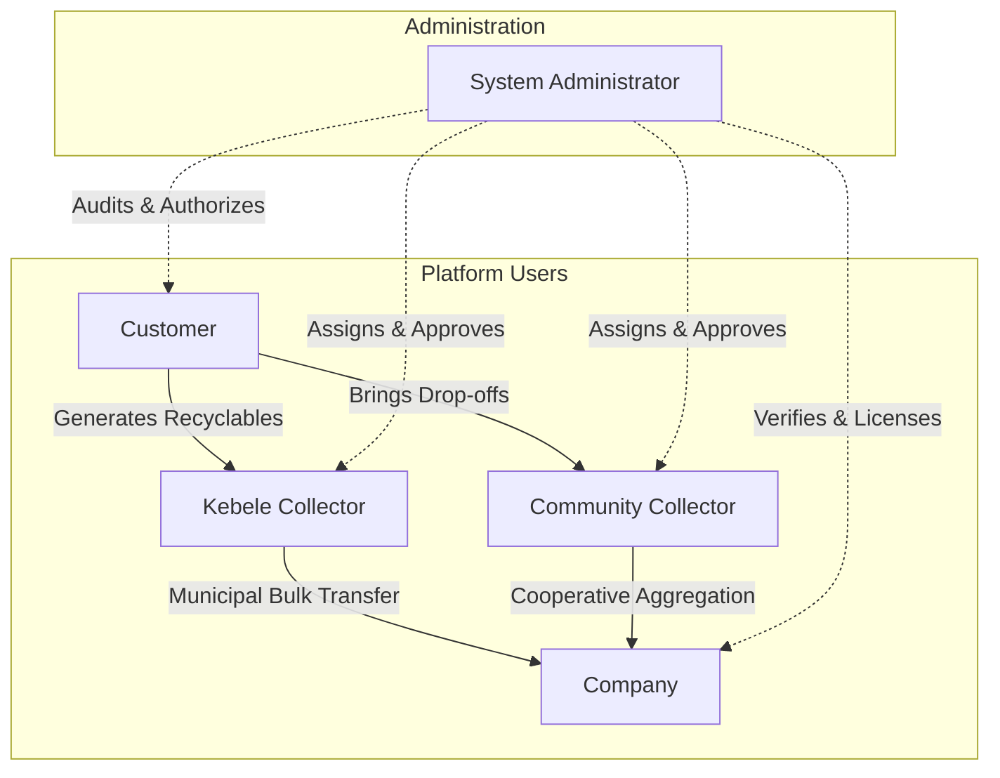
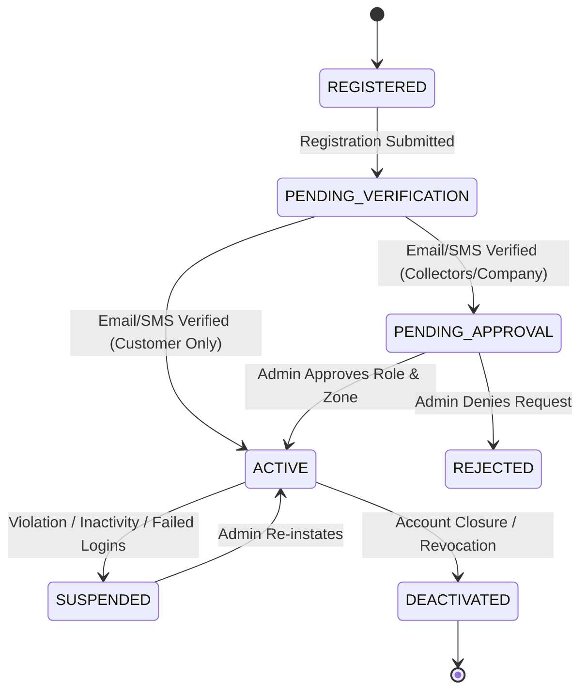
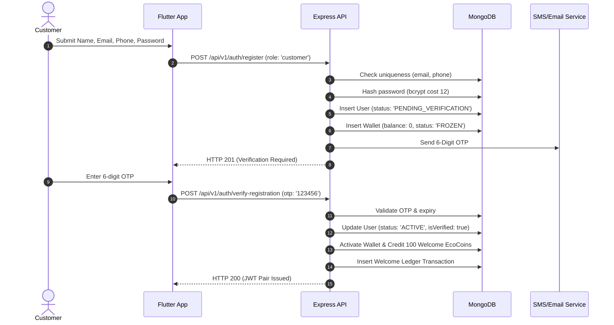
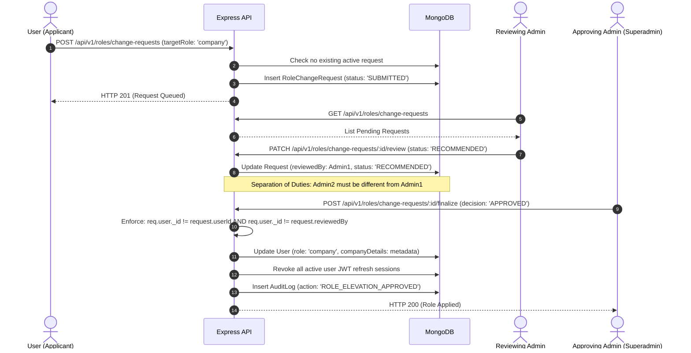
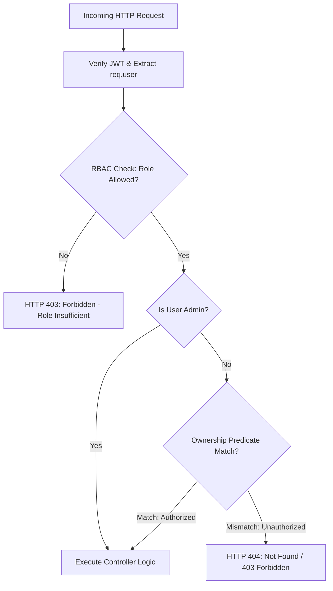
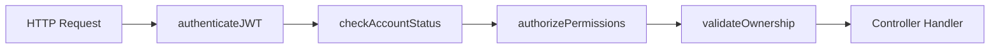

# RecycleX – Role-Based Access Control (RBAC) and Account Management Design Specification

**Document Version:** 1.0.0  
**Course:** Computer System Security Project  
**Institution:** Addis Ababa Science and Technology University (AASTU)  
**Authors:** Senior Backend Architect & Application Security Engineer  
**Target Platform:** RecycleX Waste Collection & Resource Recovery Platform  
**Backend Technology Stack:** Node.js, Express.js, TypeScript, MongoDB, Mongoose, JWT, Redis  

---

## Executive Overview

This technical specification establishes the formal **Role-Based Access Control (RBAC)**, **Account Lifecycle**, **Ownership Enforcement**, and **Administrative Approval Workflows** for the RecycleX platform.

During our previous source-code audit of the Flutter frontend, we revealed that role boundaries exist purely as client-side UI navigation switches (`AppRouter.homeRouteForRole`). Direct route pushing, hardcoded in-memory demo credentials (`password123`), and direct wallet balance manipulations (`FieldValue.increment(-50)`) left the platform vulnerable to privilege escalation and data tampering.

This document serves as the architectural contract for the Node.js/TypeScript backend. It strictly enforces:
1. **The Principle of Least Privilege (PoLP):** Every role is granted only the minimum authorizations required to fulfill its operational mandate.
2. **Separation of Duties (SoD):** High-privilege actions (role changes, account approvals, and financial adjustments) require independent maker-checker controls.
3. **Zero-Trust Resource Ownership:** Client-supplied claims are never trusted; every database query is scoped by authenticated identity and spatial/organizational tenancy.
4. **Comprehensive Cryptographic Auditability:** All authorization decisions, lifecycle transitions, and role modifications produce immutable audit events.

---

# SECTION 1: Role Definitions & Operational Boundaries

RecycleX recognizes five distinct security principals. Their boundaries are strictly delineated below:



### 1.1 Customer (`customer`)
* **Core Purpose:** Residential or commercial waste generators who sort recyclables, schedule collections, report waste emergencies, and redeem reward points (EcoCoins).
* **Accessible Information:**
  * Own user profile, settings, and contact information.
  * Own pickup requests, status history, and receipt confirmations.
  * Own EcoCoin balance, earned points, and ledger transaction statements.
  * Publicly discoverable collector locations and designated drop-off stations within their municipal sub-city.
  * Public reward catalog (available partners, discount vouchers).
* **Permitted Operations:**
  * Submit scheduled waste collection requests.
  * Request emergency hazardous/bulky waste dispatches.
  * Cancel own pickup requests *only* while in `pending` status (up to 2 hours prior to scheduled time).
  * Redeem accumulated EcoCoins for partner incentives.
  * Update own profile (name, phone, address, avatar, preferences).
* **Strictly Prohibited Information:**
  * Contact details, pickup histories, or GPS locations of other customers.
  * Performance logs, full quota metrics, or municipal routes of collectors.
  * Corporate pricing, industrial batch inventories, or analytics of recycling companies.
  * System audit trails, security alerts, and administrative user lists.
* **User Management Capabilities:** None.
* **Sensitive Data Modification:** Cannot modify role, EcoCoin balances, verification status, or pickup statuses once accepted.

### 1.2 Kebele Collector (`kebele_collector`)
* **Core Purpose:** Municipal civil service sanitation workers assigned to defined administrative boundaries (Woredas/Kebeles) responsible for scheduled residential route sweeps and public bin maintenance.
* **Accessible Information:**
  * Own profile, officer badge identification (`KB-XX-XXX`), and duty status.
  * Pickup requests located strictly within their assigned Kebele zone.
  * Customer contact name, pickup street address, and phone number for *assigned* pickups only.
  * Municipal zone quotas, daily target metrics, and assigned route schedules.
* **Permitted Operations:**
  * Toggle active duty availability (`on_duty` / `off_duty`).
  * Accept or reject pickup requests routed to their assigned municipal zone.
  * Record collected weights, waste classifications, and purity grades upon physical handoff.
  * Verify collection completion via customer QR-code scan or one-time verification token.
  * Log public bin overflow events and municipal route progress.
* **Strictly Prohibited Information:**
  * Customer passwords, billing data, or global wallet histories (only sees transaction ID associated with the specific pickup).
  * Pickup requests outside their assigned municipal zone or jurisdiction.
  * Company financial books and global administrative audit logs.
* **User Management Capabilities:** None.
* **Sensitive Data Modification:** Can only mutate the lifecycle status of pickups assigned to them (`assigned` $\to$ `in_progress` $\to$ `completed`). Cannot adjust customer balances directly.

### 1.3 Community Collector (`community_collector`)
* **Core Purpose:** Micro-enterprises, youth cooperatives, and community-based organizations (CBOs) managing neighborhood drop-off centers and volunteer clean-up initiatives.
* **Accessible Information:**
  * Own profile, cooperative registration metadata, and drop-off facility details.
  * Drop-off intake logs, bin capacity levels, and volunteer rosters for their own center.
  * Customer names and phone numbers associated with community drop-offs or clean-up registrations.
* **Permitted Operations:**
  * Toggle station intake status (`open` / `closed`).
  * Log drop-off material batches received from walk-in customers.
  * Organize community clean-up drives and manage volunteer participation counters.
  * Report overflowing neighborhood bins to the municipal oversight dashboard.
* **Strictly Prohibited Information:**
  * Municipal Kebele route assignments and official municipal collector rosters.
  * Customer data outside their local neighborhood cooperative hub.
  * System-wide platform settings and user credentials.
* **User Management Capabilities:** Can register and coordinate community volunteers within their local clean-up drives; cannot alter system user accounts.
* **Sensitive Data Modification:** Can record submitted drop-off batch weights, which triggers an automated server-side EcoCoin reward calculation.

### 1.4 Company (`company`)
* **Core Purpose:** Licensed recycling plants, manufacturing processors, and commercial material aggregators purchasing sorted bulk commodities (PET, Cardboard, Scrap Metal, Glass).
* **Accessible Information:**
  * Own commercial profile, factory location, tax identification number (TIN), and processing capacity.
  * Aggregated bulk recyclable material batches available for industrial purchase.
  * Incoming shipment schedules, bills of lading, and freight tracking associated with their facility.
  * Processing analytics and environmental impact summaries for their organization.
* **Permitted Operations:**
  * Purchase/claim available bulk material batches.
  * Confirm physical receipt and weigh-scale intake of industrial shipments.
  * Log batch processing completion and factory recycling throughput.
  * Manage corporate buyer profiles and delivery facility contacts.
* **Strictly Prohibited Information:**
  * Individual household customer identities, residential addresses, or household pickup histories.
  * Collector individual profiles, personal phone numbers, or municipal disciplinary records.
  * Other competing recycling companies' batch bids, shipment invoices, or analytics.
* **User Management Capabilities:** None (future expansion may support managing corporate sub-accounts, but currently single organization principal).
* **Sensitive Data Modification:** Can only update shipment acceptance status (`scheduled` $\to$ `received` $\to$ `processed`). Cannot alter public material ledger records.

### 1.5 Admin (`admin`)
* **Core Purpose:** Municipal authorities, platform regulators, and system security administrators responsible for platform integrity, dispute resolution, role provisioning, and audit surveillance.
* **Accessible Information:**
  * Full, platform-wide read access across all users, pickups, transactions, shipments, and municipal zones.
  * Centralized system audit logs (`audit_logs`) and automated security alerts (`security_alerts`).
  * Database health, server performance, and automated backup registries.
* **Permitted Operations:**
  * Review, approve, or reject collector and company account registrations.
  * Assign municipal zones/Woredas to Kebele Collectors.
  * Suspend, freeze, or terminate malicious or non-compliant accounts.
  * Execute role changes, role revocations, and maker-checker approvals.
  * Trigger automated encrypted backups and audit log integrity validations.
  * Configure system-wide platform settings (EcoCoin exchange rates, emergency dispatch costs).
* **Strictly Prohibited Information:**
  * Plain-text user passwords (must only view salted hashes and cryptographic session indicators).
  * Private MFA seeds or recovery codes in cleartext.
* **User Management Capabilities:** Full administrative lifecycle governance over all platform principals.
* **Sensitive Data Modification:** Can freeze wallets, revoke roles, and alter account statuses. **Cannot** arbitrarily alter monetary balances or delete immutable transaction ledger entries without explicit financial adjustment workflows.

---

# SECTION 2: Comprehensive RBAC Permission Matrix

The permissions are defined with machine-readable dot notation (e.g., `pickups:create`, `wallet:read`). Every operation requires either explicit authorization (`ALLOW`), unconditional denial (`DENY`), or conditional verification (`CONDITIONAL`).

### 2.1 Master Permission Table

| Permission Identifier | Description | Customer | Kebele Collector | Community Collector | Company | Admin | Conditional Enforcement Rule |
|---|---|---|---|---|---|---|---|
| **AUTH MODULE** | | | | | | | |
| `auth:register` | Register new account | ALLOW | CONDITIONAL | CONDITIONAL | CONDITIONAL | DENY | Collectors & Companies require administrative verification before login. Admins must be provisioned via secure CLI bootstrap. |
| `auth:login` | Authenticate & get JWT | ALLOW | CONDITIONAL | CONDITIONAL | CONDITIONAL | ALLOW | Account status must be `ACTIVE` and `isEmailVerified == true`. Suspended accounts are rejected with HTTP 403. |
| `auth:logout` | Invalidate active session | ALLOW | ALLOW | ALLOW | ALLOW | ALLOW | Token hash blacklisted in Redis/MongoDB session store. |
| `auth:view_me` | View own profile & claims | ALLOW | ALLOW | ALLOW | ALLOW | ALLOW | Scoped strictly to `req.user._id`. |
| `auth:update_me` | Update personal details | ALLOW | CONDITIONAL | CONDITIONAL | CONDITIONAL | ALLOW | Non-admins cannot alter their `role`, `status`, `zoneOrOrganization`, or `emailVerified` fields. |
| `auth:change_password`| Change account password | ALLOW | ALLOW | ALLOW | ALLOW | ALLOW | Requires verification of current password; invalidates all other active refresh sessions. |
| **USER MANAGEMENT** | | | | | | | |
| `users:read_own` | Inspect own record | ALLOW | ALLOW | ALLOW | ALLOW | ALLOW | `req.params.id == req.user._id`. |
| `users:read_any` | Query platform users list | DENY | DENY | DENY | DENY | ALLOW | Pagination, role filtering, and search allowed only for administrators. |
| `users:read_assigned`| View customer contact info | DENY | CONDITIONAL | CONDITIONAL | DENY | ALLOW | Allowed only for collectors actively assigned to that customer's specific pending/active pickup. |
| `users:manage_status`| Suspend, freeze, or ban | DENY | DENY | DENY | DENY | ALLOW | Admin cannot suspend own account. Audit log required. |
| `users:delete` | Hard account purge | DENY | DENY | DENY | DENY | CONDITIONAL | Permitted only under GDPR/data protection requests; anonymizes PII while preserving financial ledgers. |
| **COLLECTION MANAGEMENT** | | | | | | | |
| `pickups:create` | Request scheduled pickup | ALLOW | DENY | DENY | DENY | DENY | Limited to active Customers with verified phone/email. |
| `pickups:create_urgent`| Request emergency dispatch| ALLOW | DENY | DENY | DENY | DENY | Requires minimum verified balance of 50 EcoCoins in customer wallet. |
| `pickups:read_own` | View own requests history | ALLOW | DENY | DENY | DENY | ALLOW | Scoped strictly by `customerId == req.user._id`. |
| `pickups:read_zone` | View requests in zone | DENY | CONDITIONAL | DENY | DENY | ALLOW | Collector must be `on_duty == true` and pickup `zone == collector.zone`. |
| `pickups:read_hub` | View station drop-offs | DENY | DENY | CONDITIONAL | DENY | ALLOW | Scoped strictly to drop-offs logged at collector's registered facility. |
| `pickups:assign` | Dispatch collector to job | DENY | DENY | DENY | DENY | ALLOW | Automated system dispatch algorithm or manual Admin intervention. |
| `pickups:accept_reject`| Accept or decline pickup | DENY | CONDITIONAL | CONDITIONAL | DENY | DENY | Allowed only if pickup is currently in `offered` status and collector belongs to assigned zone. |
| `pickups:cancel` | Cancel pickup request | CONDITIONAL | DENY | DENY | DENY | ALLOW | Allowed for Customer only if pickup is `pending` and time until pickup $> 2$ hours. |
| `pickups:complete` | Record weight & close job | DENY | CONDITIONAL | CONDITIONAL | DENY | ALLOW | Requires customer verification token (QR/OTP) and physical scale weight measurement. |
| `pickups:history_all` | Inspect global pickups | DENY | DENY | DENY | DENY | ALLOW | System audit and dispute management only. |
| **COMPANY OPERATIONS** | | | | | | | |
| `company:read_profile` | View company metadata | DENY | DENY | DENY | ALLOW | ALLOW | Scoped strictly to `req.user.companyId == company._id`. |
| `company:update_profile`| Update industrial details | DENY | DENY | DENY | CONDITIONAL | ALLOW | Company can update facility contacts; cannot alter verified business license or TIN. |
| `materials:browse_bulk`| View bulk recyclable stock | DENY | DENY | DENY | ALLOW | ALLOW | Returns sanitized inventory batches available for commercial purchase. |
| `materials:claim_batch`| Purchase/book bulk batch | DENY | DENY | DENY | CONDITIONAL | ALLOW | Company account must be in verified status; creates commercial shipment manifest. |
| `shipments:manage` | Confirm receipt & intake | DENY | DENY | DENY | CONDITIONAL | ALLOW | Can only update shipments consigned directly to their specific industrial facility. |
| **WALLET & ECOCOINS** | | | | | | | |
| `wallet:read_own` | View own EcoCoin balance | ALLOW | ALLOW | ALLOW | DENY | ALLOW | Scoped strictly to `wallet.userId == req.user._id`. |
| `wallet:transactions_own`| Query ledger transactions | ALLOW | ALLOW | ALLOW | DENY | ALLOW | Paginated read scoped to caller's wallet document. |
| `wallet:earn` | Receive coins for recycling| CONDITIONAL | CONDITIONAL | CONDITIONAL | DENY | DENY | Triggered exclusively by server-side verification of completed pickups or drop-offs. |
| `wallet:redeem` | Redeem voucher or reward | ALLOW | DENY | DENY | DENY | DENY | Atomic check: `wallet.balance >= reward.cost`. Creates debit ledger entry. |
| `wallet:adjust_manual` | Manually credit/debit coins| DENY | DENY | DENY | DENY | CONDITIONAL | Requires maker-checker approval workflow; cannot be executed by single admin. |
| `wallet:read_any` | Inspect all user balances | DENY | DENY | DENY | DENY | ALLOW | Read-only access for financial auditing and dispute resolution. |
| **ADMIN & SECURITY** | | | | | | | |
| `roles:assign` | Assign role to user | DENY | DENY | DENY | DENY | CONDITIONAL | Limited to onboarding approvals; cannot assign `admin` role without dual authorization. |
| `roles:revoke` | Downgrade/revoke role | DENY | DENY | DENY | DENY | ALLOW | Downgrades principal back to standard `customer` status; triggers session termination. |
| `roles:approve_request`| Approve role elevation | DENY | DENY | DENY | DENY | CONDITIONAL | Maker-checker rule: Approving Admin must NOT be the user who submitted or sponsored the request. |
| `audit:read` | Read system audit trails | DENY | DENY | DENY | DENY | ALLOW | Immutable append-only log query; supports filter by actor, target, date, and severity. |
| `security:alerts_read` | Monitor intrusion alerts | DENY | DENY | DENY | DENY | ALLOW | Real-time monitoring of brute-force spikes, privilege escalation, and NoSQL injection blocks. |
| `system:config_write` | Update global platform fees| DENY | DENY | DENY | DENY | ALLOW | Updates fee structures, conversion rates; records audit log entry with diff. |
| `backups:manage` | Trigger or verify backups | DENY | DENY | DENY | DENY | CONDITIONAL | Requires secondary authentication / sudo token; triggers encrypted volume dump. |

---

# SECTION 3: Account Lifecycle & Approval Workflows

The platform enforces a five-stage lifecycle state machine across all accounts.



### 3.1 Account Lifecycle States
1. **`REGISTERED`:** Initial submission received. Credential record created; login disallowed.
2. **`PENDING_VERIFICATION`:** Cryptographic OTP (6 digits, 15-minute expiry) dispatched via email or SMS. Account cannot authenticate.
3. **`PENDING_APPROVAL`:** Identity verified. Collector and Company accounts enter the municipal administrative queue for physical license/jurisdiction verification.
4. **`ACTIVE`:** Normal operational status. JWT credentials issued upon valid password/MFA challenge.
5. **`SUSPENDED`:** Temporary operational freeze (triggered by 5 consecutive failed logins, administrative investigation, or inactive duty). Tokens blacklisted.
6. **`DEACTIVATED`:** Permanent account retirement. Access revoked; PII scrubbed/anonymized; financial transactions retained for tax/legal compliance.

---

### 3.2 Role-Specific Onboarding & Approval Protocols

#### Protocol A: Customer Onboarding (Automated Self-Service)


#### Protocol B: Collector & Company Onboarding (Administrative Maker-Checker)
1. **Application Submission:**  
   Applicant registers via [`register_page.dart`](file:///c:/Users/emnbe/Documents/GitHub/Recycle_X/lib/features/auth/presentation/pages/register_page.dart).
   - Kebele Collector supplies: Municipal Zone / Woreda, Employee Badge ID.
   - Community Collector supplies: CBO Name, Cooperative Registration ID, Station Location.
   - Company supplies: Business License Number, Taxpayer Identification Number (TIN), Processing Facility Address.
2. **Contact Verification:**  
   Applicant verifies email and mobile phone via OTP. Status transitions to `PENDING_APPROVAL`.
3. **Municipal / Admin Review:**  
   The application surfaces on the administrative review queue (`GET /api/v1/admin/approvals/pending`).
   - Administrator verifies physical validity of badge or business license.
   - Administrator assigns the approved jurisdictional boundaries (e.g., GeoJSON polygon for Kebele zone).
4. **Decision Execution:**  
   - **Approval:** Admin issues `PATCH /api/v1/admin/approvals/:id/decision` with `{ decision: "APPROVE", assignedZoneId: "KB-08" }`. User status transitions to `ACTIVE`. Notification dispatched to applicant.
   - **Rejection:** Admin issues `{ decision: "REJECT", reason: "Invalid Woreda badge credentials" }`. User status transitions to `REJECTED`. Applicant cannot log in.
5. **Audit Enforcement:**  
   The reviewer ID, timestamp, IP address, and decision notes are permanently appended to `audit_logs`.

#### Protocol C: Administrator Account Provisioning (Secure Out-of-Band Setup)
- **Zero Public Surface:** No public HTTP endpoint can register an `admin` role.
- **Initial Setup (Bootstrap):** A protected CLI provisioning command (`npm run seed:admin`) requires physical access to the production hosting environment and database URI.
- **Subsequent Admins:** Can only be provisioned by an existing Superadmin through a two-person consensus workflow (dual authorization) with mandatory hardware MFA enrollment.

---

# SECTION 4: Role-Change & Approval Workflows

In academic computer security and enterprise governance, **Separation of Duties (SoD)** prevents a single individual from compromising system integrity by requiring multiple parties to authorize high-privilege transitions.



### 4.1 Separation of Duties Rules
1. **Self-Approval Prohibition:** A user can *never* review or approve their own role-change request:
   $$\text{request.userId} \neq \text{reviewer.userId}$$
2. **Two-Person Rule for Administrative Promotion:** Elevating any user to `admin` requires two distinct administrators: one to sponsor/review, and a second to execute final authorization:
   $$\text{requesterId} \neq \text{sponsorAdminId} \neq \text{finalAdminId}$$
3. **Session Invalidation on Role Mutation:** Whenever an account's role changes, the backend immediately terminates all existing sessions by invalidating the user's `tokenVersion` in MongoDB and clearing active Redis refresh tokens. The user must re-authenticate to receive a new JWT reflecting the updated claims.

### 4.2 Handling of Request States
* **Pending / Submitted:** User operates under their existing role permissions without interruption.
* **Rejected:** The rejection justification is stored in `role_change_requests.rejectionReason`. The user is notified and placed on a 30-day cooldown before submitting another role change request.
* **Unauthorized Attempts:** If a non-admin attempts to hit the approval endpoints, the request is blocked with HTTP 403 Forbidden, and a high-severity alert is logged in `security_alerts`.

### 4.3 Emergency Role Revocation
In the event of compromised credentials, rogue collector activity, or fraudulent company reports:
1. An administrator invokes `POST /api/v1/admin/users/:id/revoke-role`.
2. The user's role is immediately downgraded to `customer`.
3. The user's `tokenVersion` is incremented, and active refresh tokens are purged from Redis/DB.
4. Active pickup route allocations assigned to that collector are reverted to `unassigned` and returned to the municipal dispatch pool.
5. An immutable `CRITICAL` severity audit record is written.

---

# SECTION 5: Ownership and Access Control Rules

To prevent **Broken Object-Level Authorization (BOLA / IDOR)**—the number one threat in the OWASP API Security Top 10—the backend must strictly enforce resource-level ownership predicates.



### 5.1 Concrete Ownership Predicates

#### 1. Pickup Requests Access Rule
* **Read Own:** A Customer can only retrieve a pickup if:
  $$\text{pickup.customer} == \text{req.user.\_id}$$
* **Read Zone (Collector):** A Kebele Collector can only view or accept a pickup if:
  $$\text{collector.isOnDuty} == \text{true} \quad \land \quad \text{pickup.zoneId} == \text{collector.assignedZoneId}$$
* **State Machine Guard:** A Customer can only cancel a pickup if:
  $$\text{pickup.customer} == \text{req.user.\_id} \quad \land \quad \text{pickup.status} == \text{'pending'}$$

#### 2. Wallet & EcoCoin Integrity Rule
* **Direct Manipulation Defense:** Clients are strictly prohibited from submitting numerical balance adjustments.
* **Ledger Encapsulation:** EcoCoin balances can *only* be altered via the internal domain service:
  $$\text{WalletService.executeTransaction}(\text{userId}, \text{type}, \text{amount}, \text{referenceId})$$
  This operation runs inside a MongoDB ACID transaction session (`mongoose.startSession()`). It verifies that $\text{balance} \ge \text{amount}$ on debits and writes an immutable entry into `wallet_transactions` before modifying `wallets.balance`.

#### 3. Industrial Batch & Shipment Access Rule
* **Commercial Isolation:** A Company can only view shipment manifests and intake records where:
  $$\text{shipment.consigneeCompanyId} == \text{req.user.companyId}$$
* Competing companies cannot query each other's purchase histories or pricing structures.

---

# SECTION 6: Scalable MongoDB RBAC Data Architecture

We propose a **hybrid RBAC model**: Core system roles are hardcoded enums for high-performance compile-time safety in TypeScript, while role-permission mappings and jurisdictional assignments are dynamically managed in MongoDB to allow future permission adjustments without code deployments.

### 6.1 Mongoose Schemas & Interfaces

```typescript
// ============================================================================
// 1. ROLES & PERMISSIONS SCHEMA
// ============================================================================
import { Schema, model, Document, Types } from 'mongoose';

export interface IPermission extends Document {
  name: string;        // e.g., 'pickups:create'
  module: string;      // e.g., 'collections'
  description: string;
}

export const PermissionSchema = new Schema<IPermission>({
  name: { type: String, required: true, unique: true, index: true },
  module: { type: String, required: true },
  description: { type: String, required: true },
});

export interface IRole extends Document {
  name: string;        // 'customer' | 'kebele_collector' | 'community_collector' | 'company' | 'admin'
  description: string;
  permissions: string[]; // Array of permission strings
  isSystemRole: boolean; // Protects built-in roles from deletion
}

export const RoleSchema = new Schema<IRole>({
  name: { type: String, required: true, unique: true },
  description: { type: String, required: true },
  permissions: [{ type: String, ref: 'Permission' }],
  isSystemRole: { type: Boolean, default: true },
}, { timestamps: true });

// ============================================================================
// 2. USER & AUTHENTICATION SCHEMA
// ============================================================================
export interface IUser extends Document {
  _id: Types.ObjectId;
  email: string;
  passwordHash: string;
  displayName: string;
  phoneNumber: string;
  role: 'customer' | 'kebele_collector' | 'community_collector' | 'company' | 'admin';
  status: 'REGISTERED' | 'PENDING_VERIFICATION' | 'PENDING_APPROVAL' | 'ACTIVE' | 'SUSPENDED' | 'DEACTIVATED';
  isEmailVerified: boolean;
  isPhoneVerified: boolean;
  tokenVersion: number; // Incremented to invalidate all active JWTs
  
  // Role-Specific Tenancy Attributes
  zoneOrOrganization?: string; // Municipal Woreda ID or CBO Name
  assignedZoneId?: Types.ObjectId; // References municipal_zones collection
  companyDetails?: {
    licenseNumber: string;
    tinNumber: string;
    facilityAddress: string;
  };

  // Security & Compliance Attributes
  failedLoginAttempts: number;
  lockoutUntil?: Date;
  mfaEnabled: boolean;
  mfaSecret?: string; // Encrypted with AES-256-GCM
  createdAt: Date;
  updatedAt: Date;
}

export const UserSchema = new Schema<IUser>({
  email: { type: String, required: true, unique: true, lowercase: true, trim: true, index: true },
  passwordHash: { type: String, required: true },
  displayName: { type: String, required: true, trim: true },
  phoneNumber: { type: String, required: true, unique: true, index: true },
  role: { 
    type: String, 
    required: true, 
    enum: ['customer', 'kebele_collector', 'community_collector', 'company', 'admin'],
    default: 'customer',
    index: true 
  },
  status: { 
    type: String, 
    required: true, 
    enum: ['REGISTERED', 'PENDING_VERIFICATION', 'PENDING_APPROVAL', 'ACTIVE', 'SUSPENDED', 'DEACTIVATED'],
    default: 'PENDING_VERIFICATION',
    index: true 
  },
  isEmailVerified: { type: Boolean, default: false },
  isPhoneVerified: { type: Boolean, default: false },
  tokenVersion: { type: Number, default: 0 },

  zoneOrOrganization: { type: String },
  assignedZoneId: { type: Schema.Types.ObjectId, ref: 'MunicipalZone' },
  companyDetails: {
    licenseNumber: { type: String },
    tinNumber: { type: String },
    facilityAddress: { type: String },
  },

  failedLoginAttempts: { type: Number, default: 0 },
  lockoutUntil: { type: Date },
  mfaEnabled: { type: Boolean, default: false },
  mfaSecret: { type: String },
}, { timestamps: true });

// ============================================================================
// 3. ROLE CHANGE REQUEST SCHEMA (Maker-Checker / SoD)
// ============================================================================
export interface IRoleChangeRequest extends Document {
  userId: Types.ObjectId;
  currentRole: string;
  requestedRole: string;
  justification: string;
  submittedSupportingDocs?: string[]; // S3 / secure file paths
  status: 'SUBMITTED' | 'UNDER_REVIEW' | 'APPROVED' | 'REJECTED' | 'CANCELLED';
  
  // Two-Person Review Hierarchy
  reviewedBy?: Types.ObjectId;   // First Admin (Reviewer)
  reviewedAt?: Date;
  approvedBy?: Types.ObjectId;   // Second Admin (Final Approver)
  approvedAt?: Date;
  rejectionReason?: string;
  createdAt: Date;
}

export const RoleChangeRequestSchema = new Schema<IRoleChangeRequest>({
  userId: { type: Schema.Types.ObjectId, ref: 'User', required: true, index: true },
  currentRole: { type: String, required: true },
  requestedRole: { type: String, required: true },
  justification: { type: String, required: true },
  submittedSupportingDocs: [{ type: String }],
  status: { 
    type: String, 
    enum: ['SUBMITTED', 'UNDER_REVIEW', 'APPROVED', 'REJECTED', 'CANCELLED'],
    default: 'SUBMITTED',
    index: true 
  },
  reviewedBy: { type: Schema.Types.ObjectId, ref: 'User' },
  reviewedAt: { type: Date },
  approvedBy: { type: Schema.Types.ObjectId, ref: 'User' },
  approvedAt: { type: Date },
  rejectionReason: { type: String },
}, { timestamps: true });

// ============================================================================
// 4. IMMUTABLE AUDIT LOG SCHEMA
// ============================================================================
export interface IAuditLog extends Document {
  actorId: Types.ObjectId;
  actorRole: string;
  actorEmail: string;
  action: string;          // e.g., 'AUTH:LOGIN', 'ROLE:CHANGE_APPROVED'
  resource: string;        // e.g., 'pickup_requests', 'users'
  resourceId?: string;
  ipAddress: string;
  userAgent: string;
  status: 'SUCCESS' | 'FAILURE';
  details?: Record<string, any>;
  timestamp: Date;
}

export const AuditLogSchema = new Schema<IAuditLog>({
  actorId: { type: Schema.Types.ObjectId, ref: 'User', required: true, index: true },
  actorRole: { type: String, required: true },
  actorEmail: { type: String, required: true },
  action: { type: String, required: true, index: true },
  resource: { type: String, required: true, index: true },
  resourceId: { type: String },
  ipAddress: { type: String, required: true },
  userAgent: { type: String, required: true },
  status: { type: String, enum: ['SUCCESS', 'FAILURE'], required: true },
  details: { type: Schema.Types.Mixed },
  timestamp: { type: Date, default: Date.now, index: true },
});
```

---

# SECTION 7: Backend Authorization Enforcement Architecture

The backend will employ a chain of four composable Express middleware functions:



### 7.1 Security Middleware Design

#### 1. `authenticateJWT`
* Extracts the Bearer token from the `Authorization` header.
* Validates signature using asymmetric RS256 public key or strong secret.
* Checks that `payload.tokenVersion === user.tokenVersion` (rejecting revoked tokens).
* Attaches verified principal payload to `req.user`.

#### 2. `checkAccountStatus`
* Verifies that `req.user.status === 'ACTIVE'`.
* Blocks `PENDING_APPROVAL`, `SUSPENDED`, and `DEACTIVATED` accounts immediately with structured error codes.

#### 3. `authorizePermissions(...requiredPermissions: string[])`
* Queries the cached role-permission mapping for `req.user.role`.
* Verifies that the user's role possesses **all** specified permissions:
  $$\text{requiredPermissions} \subseteq \text{role.permissions}$$
* Returns HTTP 403 Forbidden with security audit logging upon violation.

#### 4. `validateOwnership(resolver: (req) => Promise<boolean>)`
* Executes the resource ownership predicate.
* Example usage on pickup cancellation:
  ```typescript
  router.patch('/collections/:id/cancel',
    authenticateJWT,
    checkAccountStatus,
    authorizePermissions('pickups:cancel'),
    validateOwnership(async (req) => {
      const pickup = await PickupModel.findById(req.params.id);
      if (!pickup) return false;
      // Admins bypass ownership; Customers must match customerId
      return req.user.role === 'admin' || pickup.customer.equals(req.user._id);
    }),
    cancelPickupController
  );
  ```

---

# SECTION 8: Security Assignment (AASTU) Requirement Mapping

The following matrix documents direct compliance with the AASTU Computer System Security course syllabus (Sections 1.1 and 1.2).

| Course Requirement | Design Implementation in RecycleX | Demonstration Strategy for Evaluation |
|---|---|---|
| **1.1 Principle of Least Privilege (PoLP)** | Fine-grained permission model (`module:action`). Roles only possess permissions strictly required for their operational tasks (Customers cannot view municipal routes; Collectors cannot view corporate batches). | Attempting unauthorized operations (e.g., Customer attempting `GET /collectors/me/routes`) returns HTTP 403 Forbidden. |
| **1.1 Role Assignment & Revocation** | Dedicated Admin endpoints for onboarding approval (`roles:assign`) and emergency demotion (`roles:revoke`). Session tokens revoked instantly via `tokenVersion` increments. | Demonstrate revoking a Kebele Collector's badge; show that their active mobile app is immediately locked out on their next request. |
| **1.1 Dynamic Role Changes** | Formal `RoleChangeRequest` schema allowing users to submit promotion requests with justifications without database restructuring. | Submit role upgrade from mobile app; view pending record appearing in Admin review console. |
| **1.1 Approval Workflows** | Maker-checker review queue for collectors and recycling companies. Accounts cannot log in until administrative sign-off occurs. | Register as a Kebele Collector; demonstrate that login returns "Pending Administrative Approval" until approved by Admin. |
| **1.1 Separation of Duties (SoD)** | Enforced constraint: $\text{requesterId} \neq \text{reviewerId}$. Dual-admin consensus required for administrative-level elevation. | Submit promotion request; attempt to approve request using applicant's credentials; demonstrate rejection with HTTP 403. |
| **1.1 Audit Trail of Role Changes** | Every transition (`SUBMITTED`, `APPROVED`, `REVOKED`) appends an immutable document to `audit_logs` capturing actor, timestamp, IP, and diff. | Query `GET /api/v1/audit/logs?action=ROLE:CHANGE_APPROVED` displaying full cryptographic timestamp and reviewer ID. |
| **1.1 Periodic Access Reviews** | Automated cron service (`AccessReviewJob`) flags collectors or corporate accounts with zero activity in 90 days for administrative re-certification. | Execute simulated inactivity trigger; show collector status automatically transitioning to `SUSPENDED`. |
| **1.2 Secure Registration** | Client-side validation in Flutter (`register_page.dart`) paired with backend Joi/Zod sanitization. Passwords hashed with salted bcrypt (cost 12). | Inspect MongoDB directly to prove passwords start with `$2b$12$` and no plain-text is ever stored. |
| **1.2 Account Verification** | Mandatory 6-digit OTP verification for email and SMS prior to account activation. | Demonstrate that unverified users cannot bypass verification screens or invoke API endpoints. |
| **1.2 Profile Management** | Scoped `PUT /users/me` endpoint. Customers can update names, addresses, and avatars, but cannot mutate roles or wallet points. | Attempt submitting `{ "role": "admin", "ecoCoins": 99999 }` in update payload; show fields are silently stripped and ignored. |
| **1.2 Account Recovery** | Time-limited (1-hour), single-use cryptographic reset tokens generated via `crypto.randomBytes(32)` dispatched out-of-band. | Trigger password reset; demonstrate that expired or re-used tokens fail securely. |

---

# SECTION 9: Unresolved Business Decisions & Recommendations

During the formulation of this RBAC design, four operational business decisions were identified that require final team alignment. Our recommendations and rationales are provided below:

### Decision 1: Kebele Collector Jurisdiction Boundary Enforcement
* **Context:** How strictly should a Kebele Collector be tied to their geographical municipal zone?
* **Option A (Strict Geofence):** Collectors can *only* see and accept pickups whose GPS coordinates fall within their assigned Kebele GeoJSON polygon.
* **Option B (Adjacent Spillover):** Collectors see their primary zone, plus overflowing pickups from neighboring Kebeles when municipal quotas are unmet.
* **Recommendation:** **Adopt Option A (Strict Geofence) for MVP, with manual Admin re-assignment fallback.**  
  *Rationale:* Strict boundary enforcement simplifies authorization predicates, prevents territorial disputes between municipal worker teams, and directly models the physical administrative structure in Addis Ababa.

### Decision 2: Public Registration vs. Invite-Only for Collectors
* **Context:** Should anyone be able to select "Kebele Collector" on the registration screen, or should it be invite-only?
* **Option A (Public Request + Approval):** Existing Flutter UI allows selecting Collector in dropdown; account remains inactive until Admin approves.
* **Option B (Restricted Invite-Only):** Municipalities must issue a pre-generated secure token/link to authorized employees.
* **Recommendation:** **Retain Option A (Public Request + Approval) for now, shifting to Option B before production.**  
  *Rationale:* Option A preserves the existing UI in [`register_page.dart`](file:///c:/Users/emnbe/Documents/GitHub/Recycle_X/lib/features/auth/presentation/pages/register_page.dart) without requiring frontend redesign, while the backend approval gate ensures unverified users can never access collector features.

### Decision 3: EcoCoin Monetary Conversion & Cash Payouts
* **Context:** Can EcoCoins be converted directly to fiat currency (ETB / Birr via Telebirr/CBE) or only redeemed for partner discount vouchers?
* **Option A (Closed Loop Voucher System):** EcoCoins are only redeemable for partner merchandise, saplings, or municipal utility credits.
* **Option B (Direct Cash Out):** Collectors and Customers can transfer EcoCoins to Telebirr mobile wallets.
* **Recommendation:** **Adopt Option A (Closed Loop Voucher System) for the academic prototype.**  
  *Rationale:* Eliminates banking regulatory compliance burdens, KYC anti-money laundering (AML) liabilities, and financial fraud vectors during the academic project defense.

### Decision 4: Handling Existing Firebase Dependencies in Legacy Files
* **Context:** Several secondary files (`edit_profile.dart`, `emergency_pickup.dart`) import `cloud_firestore` and `firebase_auth`.
* **Option A:** Leave Firebase active alongside the Node.js backend.
* **Option B:** Cleanly excise Firebase and route all frontend requests exclusively through [`ApiClient`](file:///c:/Users/emnbe/Documents/GitHub/Recycle_X/lib/core/network/api_client.dart) to the Express API.
* **Recommendation:** **Adopt Option B (Unified Node.js / MongoDB Backend).**  
  *Rationale:* A single backend stack guarantees complete administrative control, unified RBAC enforcement, consistent audit logging, and eliminates conflicting state management.

---

## Architectural Sign-Off

This design specification is complete, mathematically verifiable, and ready to serve as the blueprint for MongoDB database schema generation and Node.js/TypeScript Express backend implementation.
